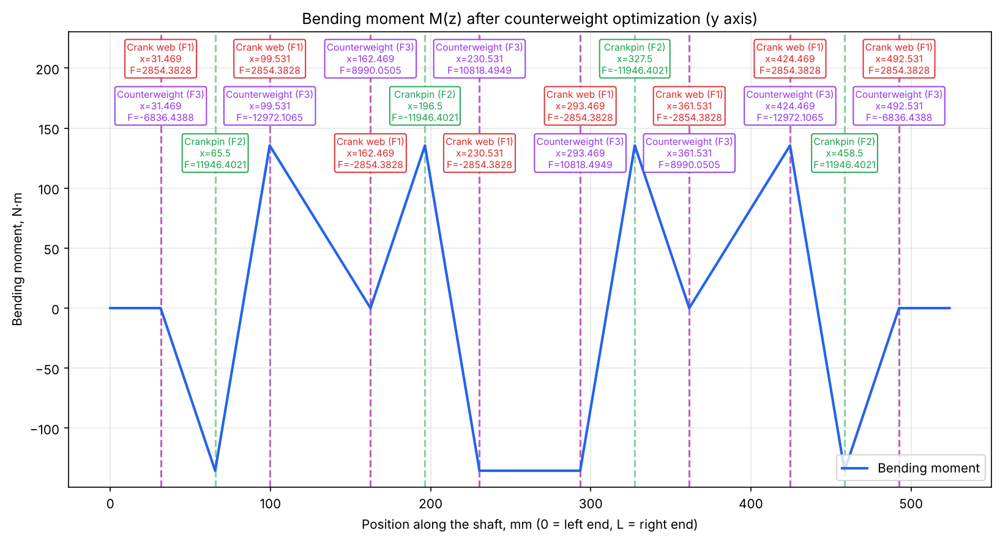
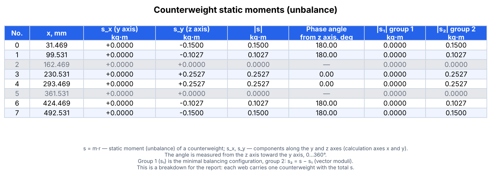
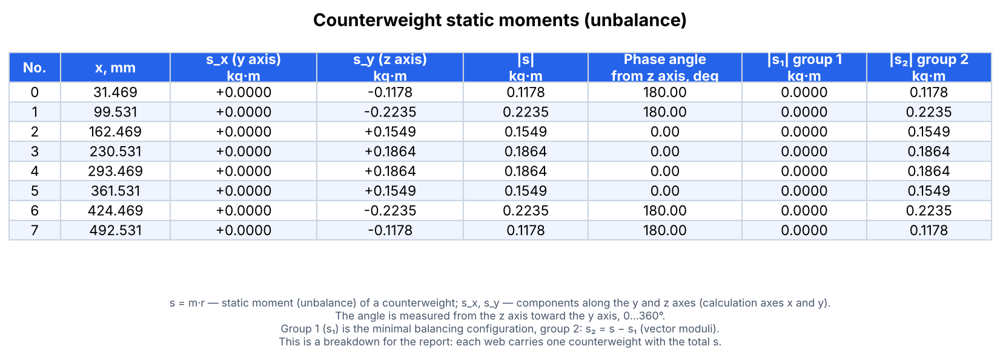

# crankshaft-balancing

[](https://github.com/rtte2077/crankshaft-balancing/actions/workflows/tests.yml)


[Русский](README.md) · **English**

Balancing of a crankshaft of **any configuration**: any number of cylinders, in-line or
V-engine, any arrangement of crank webs and crankpins.

> **Axes.** **The shaft axis is the `x` axis**: the `x` coordinate of every element is its
> position along the shaft. The cross section is the `YZ` plane, and `y` and `z` are the
> coordinates of the element's centre of mass in that plane. Note: in the calculation
> results (`result_x`, `s_x`, `Mx`) the letters "x" and "y" denote the two **components in
> the section plane** (the `y` and `z` fields of the JSON), not the shaft axis. See
> [Coordinate system](#coordinate-system-and-units) and [Axes in the calculation and in the
> JSON](#axes-in-the-calculation-and-in-the-json).

Given a description of the shaft (positions and masses of the crank webs and crankpins,
angular speed), the program:

1. computes the centrifugal inertia forces acting on the crank webs and crankpins;
2. builds the bending moment diagram `M(z)` along the shaft axis by the method of sections;
3. selects the counterweights: it finds the coefficients that minimize the maximum
   bending moment while the resultant force and the resultant external moment are zero
   (linear programming);
4. independently verifies that the minimum found is the global one.



*Bending moment diagram `M(z)` for the y axis after the counterweights have been selected
(example from the repository). Red labels — forces of the crank webs (F1), green — of the
crankpins (F2), purple — the counterweights found (F3).*

> **Language note.** This README is in English, but console messages, error messages and the
> captions of most plots produced by the program are currently in Russian. The counterweight
> table (console and picture) can be switched to English with `--table-lang en`; the plot
> function `plot_distribution` accepts custom captions (`xlabel`, `curve_label`, `title`,
> `ylabel`).

## Contents

- [Terminology](#terminology)
- [How it works](#how-it-works)
- [Installation](#installation)
- [Quick start](#quick-start)
- [Describing your own shaft](#describing-your-own-shaft)
- [Counterweight constraints](#counterweight-constraints)
- [Two groups of static moments](#two-groups-of-static-moments)
- [How the final static moments are chosen](#how-the-final-static-moments-are-chosen)
- [Coordinate system and units](#coordinate-system-and-units)
- [Table of counterweight static moments](#table-of-counterweight-static-moments)
- [Reading the results](#reading-the-results)
- [Using the library from Python](#using-the-library-from-python)
- [Verifying global optimality](#verifying-global-optimality)
- [API reference](#api-reference)
- [Repository layout](#repository-layout)
- [Tests](#tests)
- [Limitations](#limitations)
- [FAQ](#faq)
- [License](#license)

## Terminology

The code and the JSON files use short identifiers; the table shows what they mean and
which term is used in this README (and in English machine-design and balancing textbooks).

| In the code / JSON | Term used here | Notes |
|---|---|---|
| `cheek` | **crank web** (also *crank arm*) | the plate connecting a crankpin to a main journal |
| `crankpin` | **crankpin** (*crank journal*) | the journal carrying the big end of the connecting rod |
| `main_journal_*` | **main journal** | the supporting journal of the shaft |
| `rod_rotating_mass` | **equivalent rotating mass of the connecting rod** ($m_2$) | the part of the rod mass lumped at the crankpin |
| `F1`, `F2`, `F3` | centrifugal inertia forces of the crank webs, of the crankpins (with the rod's rotating mass) and of the counterweights | |
| `s` | **static moment (unbalance)** of a counterweight, $s = m\,r$, kg·m | mass times the radius of its centre of mass |
| `M(z)` | **bending moment** at section `z` (**method of sections**) | |
| "суммарный внешний момент" | **resultant external moment** (couple) | must be zero for a balanced shaft |
| `angle_deg` | **phase angle** of a counterweight, measured from the z axis | |
| `crankshaft_length`, `module_width` | shaft length; **crank throw pitch** | |

## How it works

### Forces

The centrifugal inertia force of an element of mass $m$ whose centre of mass lies at
distance $r$ from the shaft axis:

$$F = m \, r \, \omega^2$$

The force acts along the radius vector of the centre of mass in the plane of the cross
section (YZ) and is resolved into components $F_x$, $F_y$. The two components are
treated separately.

The forces fall into three groups:

| Group | What it is |
|---|---|
| `F1` | crank webs |
| `F2` | crankpins; the equivalent rotating mass of the connecting rod `rod_rotating_mass` is added to the crankpin mass |
| `F3` | counterweights: $F_3 = s \, \omega^2$, the coefficients $s_i$ are found by the optimization |

Reduction of the connecting rod masses: one part, $m_1$, is lumped at the wrist
(piston) pin — this is the reciprocating mass and it is **not** part of this calculation;
the other part, $m_2$, is lumped at the crankpin and rotates with the shaft. The program
takes $m_2$.

### Method of sections

The bending moment at section `z` is the sum of the moments of all forces applied on one
side of it:

$$M(z) = \sum_i H(z - L_i)\, F_i, \qquad H(d) = \begin{cases} d, & d > 0 \\ 0, & d \le 0 \end{cases}$$

Here $L_i$ is the distance from the **right** end of the shaft to the point of application
of the force $F_i$. The ramp function $H$ makes forces lying on the other side of the
section contribute nothing.

### Selecting the counterweights

The moment $M(z)$ is linear in the coefficients $s_i$, so $\max|M(z)|$ is a convex
function of $s$, and the minimax problem reduces to a linear program:

$$\min\; t \quad \text{subject to} \quad -t \le M(z_k) \le t \;\; \forall k,$$

$$\sum F_1 + \sum F_2 + \sum F_3 = 0 \quad \text{(force equilibrium)}, \qquad M(z_{\text{end}}) = 0 \quad \text{(resultant external moment is zero)}.$$

The condition $M(z_{\text{end}}) = 0$ requires that the **resultant external moment acting
on the shaft be zero**: in the last section $M(z)$ accounts for all the forces on the
shaft, so its value there is the resultant moment of all the forces.

The problem is solved with HiGHS (`scipy.optimize.linprog`). Unlike gradient methods
applied to the non-smooth function `max(|...|)`, linear programming guarantees the global
minimum.

The optimum in `max|M|` is usually not unique: different sets of `s` give the same
minimal peak. Among them the set with the **smallest oscillation of the diagram**
$\mathrm{osc}\,M = \max M - \min M$ is taken — in analysis, the oscillation of a
function on an interval is the difference between its largest and smallest values (here,
over the shaft length). This is a second LP: $\min (hi - lo)$ subject to
$lo \le M(z_k) \le hi$ and $\max|M|$ not above the minimum found; among those the
lightest one is taken. The peak does not change. On the examples in the repository all optimal
solutions have the same oscillation (usually $2\max|M|$: the diagram touches both $+\max$ and
$-\max$); on shafts with `bounds` constraints the choice by oscillation can nearly halve it.

The constraints on the diagram are checked only at the grid sections next to the points
where forces are applied: between those points $M(z)$ is linear, so at the other sections
they hold automatically. This is the same LP but hundreds of times smaller: a calculation
on a 0.01 mm grid takes a fraction of a second.

This is the default behaviour. The total static moment of the counterweights can be
limited to get an intermediate option between "minimal moment" and "minimal counterweight
mass" — see [Two groups of static moments](#two-groups-of-static-moments).

### Shaft length

The shaft length is not entered by hand. It is derived from the geometry by adding up the
widths of the elements in the order in which they follow along the shaft (the centre-of-mass
coordinates are used only to establish the order):

- the shaft starts with half of a main journal;
- a crank web adds `cheek_width`, a crankpin adds `crankpin_journal_width`;
- two crank webs in a row with no crankpin between them mean a supporting main journal
  between them: `main_journal_width` is added;
- the shaft ends with half of a main journal.

The widths in the `engine` block are **defaults**. Any individual crank web or crankpin
can be given its own thickness with the `width` key of the element, and any individual
main journal via `engine.main_journal_widths` (see below). The given thickness is then
used in the sum; all other elements use the defaults.

The derivation of the formulas is in [docs/theory.md](docs/theory.md) (in Russian).

## Installation

Python 3.9 or newer is required.

```bash
git clone https://github.com/rtte2077/crankshaft-balancing.git
cd crankshaft-balancing

# recommended: a separate virtual environment
python -m venv .venv
source .venv/bin/activate        # Windows: .venv\Scripts\activate

pip install -e .                 # numpy, scipy, matplotlib
```

Optional dependency sets:

```bash
pip install -e ".[interactive]"  # + plotly: interactive 3D plot
pip install -e ".[dev]"          # + pytest, plotly: for development
```

The `-e` flag installs the package in development mode: edits in `src/` take effect
without reinstalling. After installation the `crankbalance` command is available.

## Quick start

### From the command line

```bash
crankbalance examples/example_shaft.json --verify --table-lang en --out output
```

Equivalent: `python -m crankshaft_balancing examples/example_shaft.json --verify --table-lang en --out output`.

Output (abridged; the status lines are in Russian):

```
[y] max|M| = 135.5133 Н·м (минимально возможный 135.5133 Н·м), колебание эпюры max M - min M = 271.0267 Н·м
[y] баланс сил = -0.0 Н                              (force equilibrium)
[y] суммарный внешний момент M(z[-1]) = 0.0 Н·м      (resultant external moment)
...
max|Mx| = 0.0000 Н·м, max|My| = 135.5133 Н·м
Группа 2: 100 %; суммарный статический момент (l1): x = 0.000000, y = 1.365334 кг·м

Counterweight static moments s = m·r (s_x — along the JSON y axis, s_y — along the JSON z axis;
 angle — from the z axis toward the y axis, 0..360 deg)
No.     x, mm  s_x (y), kg·m  s_y (z), kg·m  |s|, kg·m angle from z, deg  |s1| gr.1, kg·m  |s2| gr.2, kg·m
----------------------------------------------------------------------------------------------------------
  0    31.469         0.0000        -0.1178     0.1178            180.00           0.0000           0.1178
  1    99.531         0.0000        -0.2235     0.2235            180.00           0.0000           0.2235
  2   162.469         0.0000         0.1549     0.1549              0.00           0.0000           0.1549
...
[y] условия ККТ выполнены -> ГЛОБАЛЬНЫЙ ОПТИМУМ ПОДТВЕРЖДЁН      (KKT conditions satisfied -> global optimum confirmed)
```

> The values of `s` may differ slightly on your machine. The optimum of the problem is not
> unique (different sets of `s` give the same minimum of `max|M|`). Among them the set with
> the smallest oscillation of the diagram is taken, and among those the one with the smallest
> sum of `|s|` (step 3 in [Two groups of static moments](#two-groups-of-static-moments)),
> but even that may not be unique. Compare `max|M|`, not individual coefficients.

Command-line options:

| Option | Purpose |
|---|---|
| `config` | path to the JSON file describing the shaft (required) |
| `--out DIR` | where to save the plots (default `output`) |
| `--step MM` | section grid step, mm (default `0.01`); a larger step is faster but slightly coarser |
| `--verify` | verify global optimality (duality and KKT conditions) |
| `--csv FILE` | save the counterweight static-moment table to CSV (without this option it is saved to `--out/counterweights.csv` together with the plots) |
| `--table-lang ru\|en` | language of the counterweight table captions in the console and in the picture (default `ru`) |
| `--group2-percent P` | share of group 2 of the static moments, 0…100 (default: the value from the JSON, otherwise 100); see [Two groups of static moments](#two-groups-of-static-moments) |
| `--norm l1\|linf` | static-moment budget: the sum of `|s_i|` (default) or `max|s_i|` |
| `--group2-sweep` | compute `p` = 0, 10, …, 100 and save `group2_tradeoff.png` and `group2_tradeoff.csv` |
| `--no-plots` | calculation only, no plots or files (the table is still printed) |
| `--sensitivity` | save sensitivity plots of `max|M|` to each coefficient `s_i` |
| `--convergence` | save convergence plots of the simplex method (coarse 2 mm grid; requires a SciPy that still has `linprog(method='simplex')`; for the x axis bounds of ±5 are set) |
| `--interactive` | additionally save an interactive 3D plot `moment_3d.html` (requires plotly) |

Files written to `--out`:

| File | Content |
|---|---|
| `moment_x_raw.png`, `moment_y_raw.png` | bending moment diagrams before optimization |
| `moment_x_optimized.png`, `moment_y_optimized.png` | diagrams after the counterweights have been selected |
| `counterweights.png` | table of counterweight static moments as a picture |
| `counterweights.csv` | the same table for Excel and scripts |
| `moment_3d.png` | resultant moment $(M_x, M_y)$ along the shaft |
| `moment_3d.html` | the same, interactive (only with `--interactive`) |
| `sensitivity_x.png`, `sensitivity_y.png` | sensitivity to the coefficients (only with `--sensitivity`) |
| `convergence_x.png`, `convergence_y.png` | progress of the simplex method (only with `--convergence`) |
| `group2_tradeoff.png`, `group2_tradeoff.csv` | `max|M|` and the total static moment versus the share of group 2 (only with `--group2-sweep`; with `--no-plots`, the CSV only) |

### From Python

```python
from crankshaft_balancing import analyze, load_shaft

engine, components = load_shaft("examples/example_shaft.json")
res = analyze(engine, components)

print(res.max_moment_y)       # max|My| after optimization, N·m
print(res.result_y["s"])      # counterweight coefficients, y axis
print(res.result_y["F3"])     # counterweight forces, N
```

A ready-made script is [`examples/run_example.py`](examples/run_example.py); a step-by-step
demonstration with plots is [`notebooks/demo.ipynb`](notebooks/demo.ipynb).

## Describing your own shaft

The shaft is described by a JSON file. Use
[`examples/example_shaft.json`](examples/example_shaft.json) as a template:

```json
{
  "engine": {
    "angular_speed": 240.9,
    "rod_rotating_mass": 1.86,
    "main_journal_width": 37.0,
    "crankpin_journal_width": 38.0,
    "cheek_width": 28.0
  },
  "components": [
    {"kind": "cheek",    "x": 31.469, "y": 0, "z": 26.5926, "mass": 1.8496},
    {"kind": "crankpin", "x": 65.5,   "y": 0, "z": 64.0,    "mass": 1.3565}
  ]
}
```

(The key `"cheek"` denotes a **crank web**.)

### The `engine` block

All keys are optional; missing ones take the defaults (which coincide with the example).

| Key | Meaning | Unit |
|---|---|---|
| `angular_speed` | angular speed of the shaft ω | rad/s |
| `rod_rotating_mass` | equivalent rotating mass of the connecting rod, lumped at the crankpin ($m_2$) | kg |
| `main_journal_width` | width of a main journal | mm |
| `crankpin_journal_width` | width of a crankpin | mm |
| `cheek_width` | width of a crank web | mm |
| `main_journal_widths` | optional: widths of individual main journals, `{"index": width}` | mm |

The widths are used **only** to derive the shaft length automatically.
`main_journal_width`, `crankpin_journal_width` and `cheek_width` are defaults for all
elements; an individual element can override them.

Main journals are numbered from left to right starting at 0: `0` is the left end journal,
the last one is the right end journal (half of an end journal's width goes into the
length), the ones in between are the supporting journals between crank throws. For
example, for the four-throw example (5 main journals):

```json
"engine": {"main_journal_width": 37.0, "main_journal_widths": {"0": 47.0, "2": 30.0}}
```

Conversion of engine speed to angular speed: $\omega = 2\pi n / 60$, where $n$ is the
speed in rpm. For $n = 2300$ rpm, $\omega \approx 240.9$ rad/s.

### The `components` list

Every crank web and every crankpin is a separate element:

| Key | Meaning | Unit |
|---|---|---|
| `kind` | `"cheek"` (crank web) or `"crankpin"` | — |
| `x` | position of the centre of mass along the shaft axis | mm |
| `y`, `z` | position of the centre of mass in the section plane | mm |
| `mass` | mass of the element | kg |
| `width` | optional: thickness of this particular element along the shaft axis; if omitted, `cheek_width` or `crankpin_journal_width` is used | mm |

For example, a crank web 32 mm thick instead of the default 28 mm:

```json
{"kind": "cheek", "x": 31.469, "y": 0, "z": 26.5926, "mass": 1.8496, "width": 32.0}
```

The order of the elements in the list does **not** matter: the program sorts them by `x`.
The number of elements and their arrangement are unrestricted, so a shaft with any number
of crank throws, or a V-engine shaft with an asymmetric arrangement, can be described.
Only the JSON changes.

Note: every element must have a non-zero radius, i.e. `y` and `z` must not both be zero
(the direction of the force is given by the vector $(y, z)$).

## Counterweight constraints

Before the optimization you can **remove the counterweight at some position**, **set a
value by hand**, or **restrict a range**. All three are described in the same way and take
effect before the problem is solved: the optimizer selects the remaining coefficients so
that force equilibrium and a zero resultant external moment still hold.

### Numbering of counterweights

The counterweights sit on the crank webs. **The number of a counterweight is the number of
its crank web counted along the shaft in ascending order of `x`, starting from 0.** The
list is printed at every run:

```
Щёки (номер противовеса: координата, мм): 0: x=31.469, 1: x=99.531, 2: x=162.469, ...
```
*(i.e. crank webs: counterweight number: position, mm)*

In code the same list is `res.geometry.cheek_centers[:, 0]`. If you specify your own
counterweight positions (see below), the number is the index in the sorted `positions` list.

### Method 1. The `counterweights` block in JSON (simplest)

Add an optional `counterweights` key to the same file that describes the shaft:

```json
{
  "engine": { "...": "..." },
  "components": [ "..." ],
  "counterweights": {
    "all": { "zero": [2, 5] },
    "y": {
      "fixed":  { "3": 0.2 },
      "bounds": { "0": [-0.15, 0.15], "7": [-0.15, 0.15] }
    }
  }
}
```

A ready-made example is [`examples/example_shaft_constrained.json`](examples/example_shaft_constrained.json):

```bash
crankbalance examples/example_shaft_constrained.json --verify
```

In this example the `counterweights` block removes the counterweights on crank webs 2 and 5
(`"all": {"zero": [2, 5]}`) and limits the outer ones. That is why those two rows of the
result table are greyed out: the coefficients there are zero by construction, the angle is
undefined (a dash), and the remaining counterweights are recomputed so that force
equilibrium and a zero resultant external moment still hold.



**What it applies to** (first-level keys):

| Key | Applies to |
|---|---|
| `"all"` | both axes (x and y) |
| `"x"` | the x axis only |
| `"y"` | the y axis only |

Constraints of an axis override `"all"`: if a crank web is fixed in `"all"` and set to a
different value in `"y"`, `"y"` wins for the y axis.

**What can be specified** (keys inside an axis):

| Key | Example | Meaning |
|---|---|---|
| `zero` | `[2, 5]` | there is no counterweight on these crank webs (coefficient `s = 0`, excluded from the optimization) |
| `fixed` | `{"3": 0.2}` | the coefficient is set by hand and does not change; its value takes part in the force and moment equilibrium |
| `bounds` | `{"0": [-0.15, 0.15]}` | the coefficient is optimized but stays within `[min, max]`; `null` may replace a bound (no limit on that side) |

In `fixed` the string `"F"` may be used instead of a number — it means `0`. `fixed` and `bounds` cannot be given for the same crank web
at the same time (`ValueError`).

> **Note on the axes.** A coefficient belongs to one axis — it is a projection of the
> counterweight vector. `"zero"` in `"y"` only zeroes the y component; to physically remove
> a counterweight from a crank web, put it in `"all"`.

### Method 2. From Python via `analyze()`

```python
from crankshaft_balancing import CounterweightConstraints, analyze, load_shaft

engine, components = load_shaft("examples/example_shaft.json")

constraints = {
    "all": CounterweightConstraints.from_dict({"zero": [2, 5]}),
    "y": CounterweightConstraints(
        fixed={3: 0.2},
        bounds={0: (-0.15, 0.15), 7: (-0.15, 0.15)},
    ),
}
res = analyze(engine, components, constraints=constraints)
print(res.result_y["s"])
```

The class can also be built from a dictionary of the same form as in the JSON
(`CounterweightConstraints.from_dict(...)`, supports `zero`, `fixed`, `bounds`).

### Method 3. Low-level call

When full control is needed, call `optimize_counterweights` directly:

```python
from crankshaft_balancing import make_initial_coefficients, optimize_counterweights

# "F" in overrides fixes the coefficient at zero (no counterweight on that crank web)
s_init = make_initial_coefficients(8, overrides={2: "F", 5: "F"})

result = optimize_counterweights(
    Z, f.L_cheeks, f.Fy_cheeks, f.L_crankpins, f.Fy_crankpins,
    engine.angular_speed, s_init,
)
```

Parameters that control the constraints:

| Parameter | What it does |
|---|---|
| `s_init` | initial coefficients; `"F"` fixes at zero; for the others the value matters only as the "fixed" value if the index is marked in `s_fixed` |
| `s_fixed` | list of `bool`, one per counterweight: `True` — keep the value from `s_init` |
| `s_bounds` | list of `(min, max)` pairs, one per counterweight, `None` — no limit |
| `L3` | points of application of the counterweights (from the right end of the shaft); by default they coincide with the crank webs |

Example: fix the first counterweight at `0.1` and optimize the others within ±0.3:

```python
s_init  = make_initial_coefficients(8, overrides={0: 0.1})
s_fixed = [True] + [False] * 7
s_bounds = [(None, None)] + [(-0.3, 0.3)] * 7      # the bound of a fixed one is ignored
result = optimize_counterweights(Z, f.L_cheeks, f.Fy_cheeks, f.L_crankpins,
                                 f.Fy_crankpins, engine.angular_speed,
                                 s_init, s_fixed=s_fixed, s_bounds=s_bounds)
```

### Custom counterweight positions

By default the counterweights sit on the crank webs. To place them elsewhere, give the
`x` coordinates (mm, in the same system as the shaft elements):

```json
"counterweights": {
  "positions": [31.469, 99.531, 262.0, 424.469, 492.531]
}
```

```python
res = analyze(engine, components, counterweight_positions=[31.469, 99.531, 262.0, 424.469, 492.531])
```

The positions are sorted in ascending order, and the numbers used by the constraints
(`zero`, `fixed`, `bounds`) refer to this sorted list. The positions must lie within the
shaft.

### Converting `s` to a counterweight mass

`s` is the product of the counterweight mass and the radius of its centre of mass:
$s = m \cdot r$ (kg·m, radius in metres). Hence:

- the mass for a known radius: $m = s / r$, with $r$ in metres ($r = R_{\text{mm}} / 1000$);
- a limit from the mass and radius available: $|s| \le m_{\max} \cdot R_{\text{mm}} / 1000$ —
  this is the value to put into `bounds`.

### Things to keep in mind

- **Minimum number of free coefficients.** Each axis has two equality conditions (force
  equilibrium and a zero resultant external moment), so you need at least **two free
  coefficients** per axis. If too many are fixed or the bounds are too narrow, there is no
  feasible solution and the calculation stops with a `RuntimeError` carrying the solver's
  message.
- **Constraints cannot improve the result.** `max|M|` with constraints is never lower than
  without them. Example from the repository: 135.5 N·m without constraints and about
  201 N·m if the counterweights on crank webs 2 and 5 are removed and the outer ones are
  limited to a magnitude of 0.15.
- **All coefficients fixed.** The optimization is not run; the calculation just shows the
  moment produced by the values you gave and prints the force balance and the resultant
  external moment. This is a convenient way to **check a set of counterweights chosen by
  hand**. Note that nothing is adjusted in this case: if the balance is not zero it is
  visible only in the printout, and `success` stays `True`. The `--verify` checks are
  skipped for such an axis.
- **Wrong numbers.** A number outside `0..n-1` raises `IndexError`; `min > max`, or `fixed`
  together with `bounds` on one crank web, raises `ValueError`.
- **Optimality checks** (duality, KKT, sensitivity) work with constraints too: they confirm
  that the solution found is the global optimum of the constrained problem.

## Two groups of static moments

The static moments of the counterweights can be split into two groups:

- **group 1** — the minimum needed to satisfy the two equalities: force equilibrium and
  a zero resultant external moment;
- **group 2** — the additional part, which only reduces `max|M|`.

Before the optimization a percentage `p` (0…100), the share of group 2, is set:

| `p` | Result |
|---|---|
| `0` | the configuration with the smallest possible total static moment that still balances the shaft (among those, the one with the smallest `max|M|`) |
| `100` (default) | the configuration with the smallest possible `max|M|` — what was computed before |
| `0 < p < 100` | intermediate configurations: the total static moment grows linearly with `p` |

### Formulation

The total static moment along an axis (the budget) is $B = \sum_i |s_i|$. The absolute
values are linearized with auxiliary variables $u_i \ge s_i$, $u_i \ge -s_i$, so all the
problems stay linear (HiGHS gives the global optimum):

1. $B_{\min}$ — minimum of $\sum u_i$ subject to the two equalities and the
   `fixed`/`bounds` constraints; the moment diagram is not constrained. This solution is
   stored as `s_group1`.
2. $M_{opt}$ — the smallest possible $\max|M|$ (the original problem).
3. $B_{\max}$ — minimum of $\sum u_i$ subject to $\max|M| \le M_{opt}(1+\varepsilon)$
   and the smallest oscillation of the diagram at that peak: among all solutions with the
   smallest moment and the smallest oscillation, the "lightest" one is taken
   ($\varepsilon$ = `budget_eps`, default $10^{-9}$).
4. For a given `p`:

$$B(p) = B_{\min} + \frac{p}{100}\,(B_{\max} - B_{\min}),$$

   and $\min t$ is solved subject to $-t \le M(z_k) \le t$, the two equalities and
   $\sum_i u_i \le B(p)$.
5. Among the solutions of step 4 (the same $\max|M|$ and budget) the one with the
   smallest oscillation of the diagram $\max M - \min M$ is taken.

Fixed coefficients (`fixed`, `zero`) enter the budget as constants. A larger `p` gives a
larger feasible set, so `max|M|` does not increase with `p`. The derivation is in
[docs/theory.md](docs/theory.md) (in Russian).

**The axes are independent.** The budget is computed for each axis separately, like the
whole calculation: $\sum|s_x|$ and $\sum|s_y|$ are minimized separately, **not** the sum
of vector magnitudes $\sum\sqrt{s_x^2 + s_y^2}$: the latter would couple the axes and take
the problem out of LP.

An optional mode `norm="linf"` (CLI: `--norm linf`) uses $\max_i |s_i|$ instead of the
sum as the budget; it is linear too.

**The groups are a breakdown for the report.** Group 2 is defined as
`s_group2 = s − s_group1` for each counterweight. These are not two physically separate
weights: each crank web carries one counterweight with the total `s`.

### How to set it

```bash
crankbalance examples/example_shaft.json --group2-percent 40
crankbalance examples/example_shaft.json --group2-sweep     # p = 0, 10, …, 100
```

In the JSON, an optional key in the `counterweights` block:

```json
"counterweights": {"group2_percent": 40}
```

From Python: `analyze(engine, components, group2_percent=40)`. An explicitly passed value
(the `analyze()` argument or `--group2-percent`) overrides the JSON.

`--group2-sweep` saves to `--out` the plot `group2_tradeoff.png` (`max|M|` and the total
static moment versus `p`, two y axes) and the table `group2_tradeoff.csv`. $B_{\min}$,
$B_{\max}$ and $M_{opt}$ do not depend on `p`, so they are computed once; for each `p`
only the step-4 problem is solved (`with_group2_percent`, `group2_sweep`).

In `example_shaft.json` the inline four-cylinder shaft is balanced by itself, so
$B_{\min} = 0$. At `p = 0` there are no counterweights and $\max|M_y| \approx 2313$ N·m;
at `p = 100`, $\max|M_y| \approx 135.5$ N·m and $\sum|s_y| \approx 1.37$ kg·m (0.01 mm
grid; on a coarser grid $B_{\max}$ is slightly different).

### What is added to the result

New keys in `result_x` and `result_y`:

| Key | Meaning |
|---|---|
| `s_group1` | solution of step 1 — the reference balancing configuration |
| `s_group2` | `s − s_group1` |
| `static_moment_sum` | budget of the final `s` (`Σ|s|` or `max|s|`), kg·m |
| `static_moment_min`, `static_moment_max` | $B_{\min}$ and $B_{\max}$, kg·m |
| `group2_percent` | the `p` used |
| `max_moment_opt` | $M_{opt}$, **N·mm** (like `M`) |

The counterweight table gets the columns `|s₁| group 1` and `|s₂| group 2` (vector
magnitudes); the CSV gets the components `s1_x_kg_m`, `s1_y_kg_m`, `s2_x_kg_m`,
`s2_y_kg_m`. Values below $10^{-9}$ of the maximum are zeroed as numerical noise.

### Edge cases

- If the two equalities cannot hold under the given `fixed`/`bounds`, a `RuntimeError`
  with an explanation is raised.
- If $B_{\max} = B_{\min}$, all `p` give the same solution; this is reported in the output.
- If all coefficients are fixed, no optimization is run and `group2_percent` is ignored:
  `s_group1 = s`, `s_group2 = 0`.

## How the final static moments are chosen

The final static moments of the counterweights `s` are obtained by a chain of linear
programs. Each next problem chooses only among the best solutions of the previous one,
so a more important criterion is never worsened for the sake of a less important one.
Everything is computed **for each axis separately** (calculation axes x and y), and then
the components `s_x`, `s_y` are combined into the table.

**Always satisfied** (in every step below):

- force equilibrium $\sum F_1 + \sum F_2 + \sum F_3 = 0$;
- zero resultant external moment $M(z_{\text{end}}) = 0$;
- the constraints from `counterweights`: `zero`/`fixed` (the coefficient is given and
  not optimized), `bounds` (range), `positions` (where the counterweights are).

**Steps** (for each axis):

| Step | Problem | Result |
|---|---|---|
| 1 | $\min \sum\|s_i\|$ | $B_{\min}$ — the smallest total static moment that balances the shaft; this solution is group 1 (`s_group1`) |
| 2 | $\min \max\|M\|$ | $M_{opt}$ — the smallest possible peak of the diagram |
| 3 | $\min (\max M - \min M)$ subject to $\max\|M\| = M_{opt}$ | $R_{opt}$ — the smallest oscillation of the diagram among the solutions with the smallest peak |
| 4 | $\min \sum\|s_i\|$ subject to $\max\|M\| = M_{opt}$ and oscillation $R_{opt}$ | $B_{\max}$ — the lightest of those solutions |
| 5 | $\min \max\|M\|$ subject to $\sum\|s_i\| \le B(p)$ | $T(p)$ — the smallest peak within the budget $B(p) = B_{\min} + \tfrac{p}{100}(B_{\max} - B_{\min})$ |
| 6 | $\min (\max M - \min M)$ subject to $\max\|M\| = T(p)$ and $\sum\|s_i\| \le B(p)$ | **the final `s`** |

Order of importance of the criteria: first the **peak** `max|M|`, then the **oscillation** of
the diagram `max M − min M`, then the **mass** of the counterweights $\sum|s_i|$. With
`p = 100` (default) the result is the solution with the smallest peak, among those the
one with the smallest oscillation, and among those the lightest. With `p < 100` the total
static moment is limited by $B(p)$, and within that budget the same order "peak, then
oscillation" applies.

The equalities in steps 3–6 ("subject to $\max|M| = M_{opt}$" etc.) hold with the
relative tolerance `budget_eps` = $10^{-9}$, so that the solver is not stopped by
round-off.

**After the calculation:**

- `s_group2 = s − s_group1` — a breakdown for the report (see
  [Two groups of static moments](#two-groups-of-static-moments));
- values below $10^{-9}$ of the maximum are zeroed as numerical noise;
- the axis components are combined into the magnitude $|s| = \sqrt{s_x^2 + s_y^2}$ and
  the angle from the z axis — these are the rows of the
  [counterweight table](#table-of-counterweight-static-moments);
- the counterweight mass is obtained by dividing by the radius of its centre of mass:
  $m = |s| / r$ (see [Converting `s` to a counterweight mass](#converting-s-to-a-counterweight-mass)).

**Example** (`examples/example_shaft.json`, y axis, `p = 100`): $B_{\min} = 0$ (the
shaft is balanced by itself), $M_{opt} = 135.51$ N·m, $R_{opt} = 271.03$ N·m,
$B_{\max} = 1.3653$ kg·m. The final `s_y`: −0.1178, −0.2235, +0.1549, +0.1864, +0.1864,
+0.1549, −0.2235, −0.1178 kg·m — a symmetric set with the sum 1.3653 kg·m.

Global optimality of the final result is verified on the last problem (step 6) with the
dual certificate and the KKT conditions (`--verify`). If several equivalent solutions
remain after all the steps, the solver returns one of them; this does not affect
`max|M|`, the oscillation or the sum of `|s|`.

## Coordinate system and units

- The `x` axis runs along the shaft axis; `y`, `z` lie in the plane of the cross section.
- Inside the calculation the section coordinate `z` is measured from the **right** end of
  the shaft and increases toward the left. On all plots it is converted to the ordinary
  coordinate `x = L − z`, where 0 is the left end of the shaft.
- Lengths and coordinates are in **mm**, masses in **kg**, forces in **N**.
- `result["M"]` is stored in **N·mm**; the plots and the `max_moment_x/y` properties are
  already in **N·m**. The conversion constant is `NMM_TO_NM = 1e-3`.

## Table of counterweight static moments

After every calculation a table is printed: for each counterweight, its position along the
shaft, its static moment (unbalance) `s = m·r` (kg·m) **by components**, its **resultant
magnitude** and its **phase angle from the z axis**. The same table is saved as a picture
`counterweights.png` and as `counterweights.csv`.



*Example `examples/example_shaft.json`: counterweights have been selected on all 8 crank
webs. If a counterweight has been removed by a constraint (`zero`), its row is greyed out
and shows a dash instead of an angle — see the example in the section [Counterweight
constraints](#counterweight-constraints).*

| Column | Meaning |
|---|---|
| `No.` | counterweight number (from 0, ascending `x`) |
| `x, mm` | position of the counterweight along the shaft |
| `s_x (y)` | component along the calculation x axis; this is the `y` field in the JSON |
| `s_y (z)` | component along the calculation y axis; this is the `z` field in the JSON |
| `\|s\|` | resultant magnitude $\sqrt{s_x^2 + s_y^2}$ |
| `angle from z` | phase angle of the counterweight: from the z axis toward the y axis, 0…360° |
| `\|s1\| gr.1`, `\|s2\| gr.2` | vector magnitudes of group 1 and group 2 (`s2 = s − s1`), see [Two groups of static moments](#two-groups-of-static-moments); the CSV has the components `s1_x_kg_m`, `s1_y_kg_m`, `s2_x_kg_m`, `s2_y_kg_m` |

### Axes in the calculation and in the JSON

The system is planar: the shaft runs along the `x` axis and the cross section is the `YZ`
plane. In the calculation the components are called `x` and `y` because they are the first
and second coordinates of the section plane:

| In the calculation (`result_x`, `s_x`, `Mx`) | In the JSON and on the sketch |
|---|---|
| "x" axis | **y** axis (the `y` field of a component) |
| "y" axis | **z** axis (the `z` field of a component) |

This is why in the example, where every element has `y = 0`, the component `s_x` is zero
and the whole vector lies on the z axis.

### How the angle is computed

$$\varphi = \text{atan2}(s_x, s_y) \bmod 360^\circ$$

The angle is measured from the positive direction of the z axis toward the positive
direction of the y axis:

| Vector $(s_x, s_y)$ | Angle |
|---|---|
| $(0, +)$ — along $+z$ | 0° |
| $(+, 0)$ — along $+y$ | 90° |
| $(0, -)$ — along $-z$ | 180° |
| $(-, 0)$ — along $-y$ | 270° |

The vector $(s_x, s_y)$ points the same way as the radius vector of the counterweight's
centre of mass (the centrifugal force of the counterweight, $F_3 = s\,\omega^2$, is
directed along it), so the angle shows on which side of the shaft axis the centre of mass
of the counterweight lies.

If the counterweight has been removed (`s = 0`, see [Counterweight
constraints](#counterweight-constraints)), the angle is undefined: the table shows a dash
and the CSV an empty cell. Components smaller than $10^{-9}$ of the largest one are treated
as solver noise and set to zero, so that the angle does not jump between 0° and 360°.

### From Python

```python
from crankshaft_balancing import (analyze, counterweight_rows, format_counterweight_table,
                                  save_counterweight_csv)
from crankshaft_balancing.plotting import plot_counterweight_table

res = analyze(engine, components)
rows = counterweight_rows(res)                       # list of CounterweightRow
print(format_counterweight_table(rows, lang="en"))   # "ru" (default) or "en"
save_counterweight_csv(rows, "counterweights.csv")
plot_counterweight_table(rows, save_path="counterweights.png", lang="en")   # or .pdf / .svg

rows[3].s_x, rows[3].s_y, rows[3].s_abs, rows[3].angle_deg
```

If you need other positive directions or want the angle measured from another axis, it is
enough to change the formula in `rows_from_components`
(`src/crankshaft_balancing/report.py`).

## Reading the results

`analyze()` returns a `BalanceResult` object:

| Field | What it is |
|---|---|
| `engine` | parameters with the computed `crankshaft_length` |
| `geometry` | arrays of coordinates and masses of crank webs and crankpins (sorted by `x`) |
| `Z` | section grid, mm |
| `forces` | forces `F1`, `F2` and their points of application `L` (`ShaftForces`) |
| `module_width` | crank throw pitch, mm |
| `L_counterweights` | points of application of the counterweights (from the right end of the shaft); they coincide with the crank webs unless positions are given |
| `result_x`, `result_y` | optimization results for the x and y axes |
| `max_moment_x`, `max_moment_y` | maximum bending moment magnitude after optimization, N·m |

Each of `result_x` / `result_y` is a dictionary:

| Key | What it is |
|---|---|
| `s` | counterweight coefficients $s_i$, one per crank web (in ascending `x`) |
| `F3` | counterweight forces $s_i \omega^2$, N |
| `M` | bending moment diagram after optimization, N·mm |
| `success` | flag of a successful LP solution |
| `result` | the original `scipy.optimize.linprog` object |
| `lp` | the problem matrices (needed by the optimality checks) |

**Meaning of the coefficient `s`.** The counterweight force is $F_3 = s\,\omega^2$ and a
centrifugal force is $m\,r\,\omega^2$, so $s$ is the static moment (unbalance) of the
counterweight — its mass times the radius of its centre of mass (kg·m). The components
$s_x$ and $s_y$ give the counterweight vector in the section plane; the resultant is
$\sqrt{s_x^2 + s_y^2}$ (`plot_moment_3d` returns it as `s_combined` and the components as
`s_vectors`). The sign gives the direction along the corresponding axis. The counterweights
are tied to the crank web positions, so there are as many as there are crank webs.

**Criteria for a correct result:**

- `success == True`;
- the printed "force balance" and "resultant external moment" are zero (to about 1e-6);
- with `--verify` the message "global optimum confirmed" is printed.

## Using the library from Python

### Step-by-step calculation without `analyze()`

```python
from crankshaft_balancing import (
    EngineConfig, ShaftComponent, build_geometry, derive_crankshaft_dimensions,
    section_grid, compute_forces, make_initial_coefficients,
    optimize_counterweights,
)

engine = EngineConfig(angular_speed=240.9, rod_rotating_mass=1.86)
components = [
    ShaftComponent("cheek",    31.469, 0,  26.5926, 1.8496),   # crank web
    ShaftComponent("crankpin", 65.5,   0,  64.0,    1.3565),
    # ... the remaining elements
]

geometry = build_geometry(components)
engine.crankshaft_length, pitch = derive_crankshaft_dimensions(geometry, engine)

Z = section_grid(engine.crankshaft_length, step=0.01)
f = compute_forces(geometry, engine)

result_y = optimize_counterweights(
    Z, f.L_cheeks, f.Fy_cheeks, f.L_crankpins, f.Fy_crankpins,
    engine.angular_speed, make_initial_coefficients(len(f.Fy_cheeks)), axis="y",
)
```

### Counterweight constraints

Removing a counterweight at a position, fixing a value, limiting a range, or specifying
your own positions — see [Counterweight constraints](#counterweight-constraints).

### Plots

All functions in `crankshaft_balancing.plotting` accept `save_path` (save to a file) and
`show` (open a window) and return a `matplotlib.figure.Figure`:

```python
from crankshaft_balancing.plotting import plot_distribution, plot_moment_3d

plot_distribution(res.Z, res.result_y["M"] * 1e-3, res.engine.crankshaft_length,
                  title="Bending moment after optimization", ylabel="Bending moment, N·m",
                  xlabel="Position along the shaft, mm", curve_label="Bending moment",
                  save_path="my_plot.png", show=False)

plot_moment_3d(res.Z, res.result_x, res.result_y,
               shaft_length=res.engine.crankshaft_length,
               interactive=True, save_path="moment_3d.html")   # requires plotly
```

## Verifying global optimality

Three independent checks; none of them changes the optimization result.

1. **Duality certificate** — `verify_optimum_via_duality(result)`.
   The dual linear program is built and solved. By the strong duality theorem the optima of
   the primal and dual problems coincide if and only if the solution is globally optimal.
   This is the strictest proof.
2. **KKT conditions** — `verify_kkt_conditions(result)`. Using the Lagrange multipliers
   already returned by HiGHS, primal and dual feasibility, stationarity and complementary
   slackness are checked.
3. **Sensitivity** — `sweep_sensitivity(...)` and `plot_sensitivity(...)`.
   Each coefficient $s_i$ is varied around the optimum (the others stay at their optimal
   values) and `max|M|` is recomputed directly from the formula, without the solver. A
   convex "bowl" with its minimum at the point found is a graphic confirmation. This is a
   visual check, not a formal proof, unlike items 1 and 2.

```python
from crankshaft_balancing import verify_optimum_via_duality, verify_kkt_conditions

verify_optimum_via_duality(res.result_y, axis="y")
verify_kkt_conditions(res.result_y, axis="y")
```

### Convergence plot of the simplex method

`optimize_counterweights_history` returns the value of `max|M|` at each iteration. It uses
SciPy's `simplex` method, which is deprecated, orders of magnitude slower than HiGHS and
not available in every SciPy version, so use it on a coarse grid
(`section_grid(L, step=2.0)`). If the method is unavailable a `RuntimeError` with an
explanation is raised; the main calculation does not depend on it.

## API reference

Everything below is importable directly from `crankshaft_balancing`, except the plots
(`crankshaft_balancing.plotting`).

| Function / class | Purpose |
|---|---|
| `analyze(engine, components, step=0.01, constraints=None, counterweight_positions=None, group2_percent=100, norm="l1")` | end-to-end calculation, returns `BalanceResult` |
| `with_group2_percent(res, p)`, `group2_sweep(res, percents)` | recalculation with another share of group 2 without repeating steps 1–3; trade-off table |
| `CounterweightConstraints(fixed, bounds)` | counterweight constraints for one axis; `from_dict` understands `zero`/`fixed`/`bounds` |
| `load_constraints(path)`, `load_counterweight_positions(path)`, `load_group2_percent(path)` | read the `counterweights` block from the JSON |
| `load_shaft(path)` | reads the JSON, returns `(EngineConfig, list of ShaftComponent)` |
| `EngineConfig` | angular speed, connecting rod mass, default section widths, `main_journal_widths` |
| `ShaftComponent(kind, x, y, z, mass, width=None)` | one shaft element (crank web or crankpin); `width` is its own thickness |
| `build_geometry(components)` | sorts by `x`, splits into crank webs and crankpins |
| `derive_crankshaft_dimensions(geometry, engine)` | shaft length and crank throw pitch |
| `compute_forces(geometry, engine)` | forces and points of application (`ShaftForces`) |
| `raw_moments(Z, forces)` | bending moment diagrams $M_x$, $M_y$ before optimization, N·m |
| `section_grid(length, step)` | section grid |
| `total_distribution(z, L1, F1, L2, F2, F3, L3)` | bending moment by the method of sections, N·mm |
| `make_initial_coefficients(n, default, overrides)` | initial `s` with the possibility of fixing |
| `build_counterweight_lp(...)` | assembles the LP matrices |
| `optimize_counterweights(..., group2_percent=100, norm="l1", budget_eps=1e-9)` | counterweight selection (HiGHS) with a static-moment budget |
| `minimal_static_moment(...)`, `minimal_moment_budget(...)` | step 1 (`s`, $B_{\min}$) and steps 2–3 (`s`, $B_{\max}$, $M_{opt}$) |
| `static_moment(s, norm)` | `Σ|s|` or `max|s|` |
| `optimize_counterweights_history(...)` | the same with the iteration history (simplex); takes the same `s_init`, `s_fixed`, `s_bounds`, `L3` |
| `verify_optimum_via_duality`, `verify_kkt_conditions` | optimality certificates |
| `sweep_sensitivity(...)` | variation of `s_i` around the optimum |
| `counterweight_rows(res)`, `format_counterweight_table(rows, lang)`, `save_counterweight_csv(rows, path)` | table of static moments: components, magnitude, phase angle from the z axis |
| `plotting.plot_counterweight_table(rows, save_path, lang)` | the table as a picture (PNG, PDF, SVG; captions `ru` or `en`) |
| `plotting.plot_distribution` | bending moment diagram with force labels; axis and curve captions are set by `xlabel`, `curve_label` |
| `plotting.plot_moment_3d` | 3D plot of $(M_x, M_y)$, static or interactive |
| `plotting.plot_convergence`, `plotting.plot_sensitivity` | convergence and sensitivity |
| `plotting.plot_group2_tradeoff(rows, norm)` | `max|M|` and the static moment versus the share of group 2 |

Every function has a docstring (in Russian) describing its parameters: `help(optimize_counterweights)`.

## Repository layout

```
crankshaft-balancing/
├── src/crankshaft_balancing/
│   ├── config.py        # EngineConfig: operating parameters and section widths
│   ├── geometry.py      # ShaftComponent, build_geometry, shaft length derivation
│   ├── forces.py        # centrifugal inertia forces
│   ├── sections.py      # method of sections, M(z)
│   ├── optimization.py  # LP for the counterweight selection
│   ├── constraints.py   # counterweight constraints (zero / fixed / bounds)
│   ├── verification.py  # duality, KKT, sensitivity
│   ├── plotting.py      # all plots
│   ├── report.py        # table of counterweight static moments (components, magnitude, angle)
│   ├── analysis.py      # analyze() — end-to-end calculation
│   ├── loader.py        # reading the shaft from JSON
│   └── cli.py           # the crankbalance command
├── examples/
│   ├── example_shaft.json             # example shaft (4 crank throws, 12 elements)
│   ├── example_shaft_constrained.json # the same shaft + counterweight constraints
│   └── run_example.py                 # example of using it as a library
├── notebooks/demo.ipynb     # demonstration with plots
├── tests/                   # pytest
├── docs/theory.md           # problem statement and formulas (Russian)
├── docs/make_readme_images.py  # regenerates the pictures in docs/img (ru and en)
├── .github/workflows/       # automated tests on GitHub Actions
├── pyproject.toml           # package metadata and dependencies
└── requirements.txt
```

## Tests

```bash
pip install -e ".[dev]"
pytest
```

What the tests check:

- geometry: the input order does not affect the result, an unknown element type is rejected,
  the length and crank throw pitch of the example are 524 and 131 mm;
- forces: units, direction of the vectors;
- method of sections: linearity of the moment produced by a single force;
- optimization: zero force balance and zero resultant external moment; the mirrored set of
  coefficients is also optimal for a symmetric shaft; the value of max|M| (regression against
  the original calculation); fixing of coefficients; duality and KKT certificates;
- constraints: `zero`, `fixed`, `bounds`, an axis overriding `all`, custom counterweight
  positions, infeasible formulations (`RuntimeError`), wrong numbers and bounds, optimality
  certificates with constraints;
- the counterweight table: the angle convention (0°/90°/180°/270°), magnitude, a dash for a
  removed counterweight, robustness to solver noise, CSV, the table picture (ru/en, PNG and SVG);
- the command line: creation of the plot files, `--sensitivity`, `--convergence`, table
  output, `--csv`.

## Limitations

- All forces are taken in the YZ plane of the cross section and the shaft is treated as
  perfectly rigid; deflections and natural frequencies are not considered.
- By default the counterweights sit on the crank webs; other positions are given through
  `counterweight_positions` (see the constraints section).
- The maximum bending moment along the shaft is minimized subject to zero resultant force
  and zero resultant external moment. Other criteria (for example, bearing loads) are not
  implemented.
- In the example the moment about the x axis is zero by construction (all centres of mass
  lie in the plane `y = 0`), so the optimization for it is trivial.
- A fine grid (`--step 0.01`) gives tens of thousands of sections and large LP matrices; the
  duality check builds an even larger problem. Use `--step 0.1` for quick estimates.
- `optimize_counterweights_history` depends on the deprecated `simplex` method (see above).
- The result is a calculation model, not a substitute for engineering verification.

## FAQ

**`nan` appears in the forces together with a division-by-zero warning.** For some element
`y = z = 0`: the radius is zero and the direction of the force is undefined. Give the
coordinates of the centre of mass.

**An "unknown element type" error (in Russian).** Only `"cheek"` (crank web) and
`"crankpin"` are allowed in `kind`.

**How do I get the shaft length without running the optimization?**
`derive_crankshaft_dimensions(build_geometry(components), engine)`.

**The calculation takes too long.** Increase `--step` (or the `step` parameter of
`analyze`); enable `--verify` only when you actually need the check.

**How do I remove the counterweight from one of the crank webs?** Add to the JSON
`"counterweights": {"all": {"zero": [web_number]}}`; details are in the section
[Counterweight constraints](#counterweight-constraints).

**How do I change the engine speed?** Change `angular_speed` in the `engine` block (rad/s).
The moments are proportional to $\omega^2$, while the coefficients `s` do not depend on the
speed.

**How do I describe a shaft with a different number of cylinders?** Just list its crank
webs and crankpins in `components`. No code changes are needed.

## License

MIT — see [LICENSE](LICENSE).
