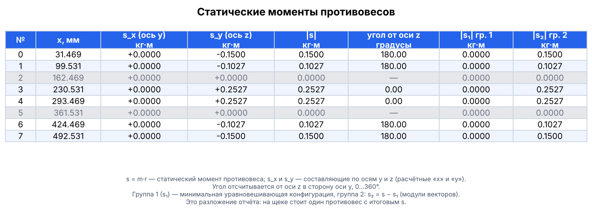
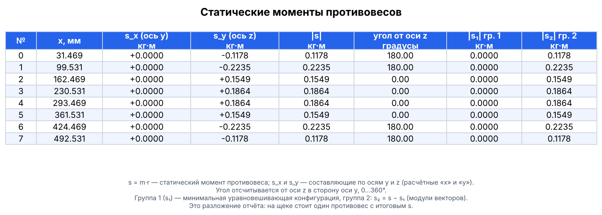

# crankshaft-balancing

[](https://github.com/rtte2077/crankshaft-balancing/actions/workflows/tests.yml)


**Русский** · [English](README.en.md)

Расчёт балансировки коленчатого вала **любой конфигурации**: любое число цилиндров,
рядный или V-образный двигатель, любая раскладка щёк и шатунных шеек.

> **Оси.** **Ось вала — ось `x`**: координата `x` каждого элемента — его положение вдоль
> вала. Поперечное сечение — плоскость `YZ`, а `y` и `z` — координаты центра масс элемента
> в этой плоскости. Внимание: в результатах расчёта (`result_x`, `s_x`, `Mx`) буквы «x» и
> «y» обозначают две **составляющие в плоскости сечения** (поля `y` и `z` в JSON), а не ось
> вала. Подробнее — в разделах [Система координат](#система-координат-и-единицы-измерения)
> и [Оси в расчёте и в JSON](#оси-в-расчёте-и-в-json).

Программа берёт описание вала (координаты и массы щёк и шеек, обороты) и:

1. считает центробежные силы инерции, действующие на щёки и шатунные шейки;
2. методом сечений строит эпюру изгибающего момента `M(z)` вдоль оси вала;
3. подбирает противовесы: коэффициенты, при которых максимальный момент минимален,
   а суммарная сила и суммарный внешний момент равны нулю (линейное программирование);
4. независимо проверяет, что найденный минимум действительно глобальный.


*Эпюра момента `M(z)` по оси Y после подбора противовесов для примера из репозитория.
Красные подписи — силы щёк (F1), зелёные — шатунных шеек (F2), фиолетовые — найденные
противовесы (F3).*

## Содержание

- [Что внутри и как это работает](#что-внутри-и-как-это-работает)
- [Установка](#установка)
- [Быстрый старт](#быстрый-старт)
- [Описание своего вала](#описание-своего-вала)
- [Ограничения на противовесы](#ограничения-на-противовесы)
- [Система координат и единицы измерения](#система-координат-и-единицы-измерения)
- [Таблица статических моментов противовесов](#таблица-статических-моментов-противовесов)
- [Как читать результаты](#как-читать-результаты)
- [Использование из Python](#использование-из-python)
- [Проверка глобальности оптимума](#проверка-глобальности-оптимума)
- [Справочник по API](#справочник-по-api)
- [Соответствие исходному ноутбуку](#соответствие-исходному-ноутбуку)
- [Структура репозитория](#структура-репозитория)
- [Тесты](#тесты)
- [Ограничения](#ограничения)
- [Частые вопросы](#частые-вопросы)
- [Лицензия](#лицензия)

## Что внутри и как это работает

### Силы

Центробежная сила элемента массой $m$ с центром масс на расстоянии $r$ от оси вала:

$$F = m \, r \, \omega^2$$

Сила направлена вдоль радиус-вектора центра масс в плоскости поперечного сечения (YZ)
и раскладывается на компоненты $F_x$, $F_y$. Расчёт ведётся отдельно по каждой оси.

Силы делятся на три группы:

| Группа | Что это |
|---|---|
| `F1` | щёки вала |
| `F2` | шатунные шейки; к массе шейки добавляется вращающаяся часть приведённой массы шатуна `rod_rotating_mass` |
| `F3` | противовесы: $F_3 = s \, \omega^2$, коэффициенты $s_i$ подбираются оптимизацией |

Метод приведения масс шатуна: часть массы $m_1$ считается сосредоточенной в поршневом
пальце (возвратно-поступательное движение, в этот расчёт не входит), часть $m_2$ — в
шатунной шейке (вращается вместе с валом). В программу передаётся именно $m_2$.

### Метод сечений

Момент в сечении `z` равен сумме моментов всех сил, приложенных с одной стороны от него:

$$M(z) = \sum_i H(z - L_i)\, F_i, \qquad H(d) = \begin{cases} d, & d > 0 \\ 0, & d \le 0 \end{cases}$$

Здесь $L_i$ — расстояние от **правого** конца вала до точки приложения силы $F_i$.
Функция $H$ нужна, чтобы силы с другой стороны от сечения не давали вклада.

### Подбор противовесов

Момент $M(z)$ линейно зависит от коэффициентов $s_i$, поэтому $\max|M(z)|$ — выпуклая
функция от $s$, и задача сводится к линейной программе:

$$\min\; t \quad \text{при} \quad -t \le M(z_k) \le t \;\; \forall k,$$

$$\sum F_1 + \sum F_2 + \sum F_3 = 0 \quad \text{(баланс сил)}, \qquad M(z_{\text{end}}) = 0 \quad \text{(суммарный внешний момент равен нулю)}.$$

Условие $M(z_{\text{end}}) = 0$ — это требование, чтобы **суммарный внешний момент,
действующий на вал, был равен нулю**: в последнем сечении $M(z)$ учитывает все силы вала,
поэтому её значение там и есть суммарный момент всех сил.

Решает её HiGHS (`scipy.optimize.linprog`). В отличие от градиентных методов на негладкой
функции `max(|...|)`, ЛП гарантирует глобальный минимум.

### Длина вала

Длина вала не задаётся вручную. Она вычисляется из геометрии последовательным
суммированием ширин элементов в порядке их следования вдоль вала (координаты центров
масс используются только для определения порядка):

- вал начинается с половины коренной шейки;
- щека добавляет `cheek_width`, шатунная шейка — `crankpin_journal_width`;
- если подряд идут две щеки без шатунной шейки между ними, между ними опорная коренная
  шейка, добавляется `main_journal_width`;
- вал заканчивается половиной коренной шейки.

Ширины из блока `engine` — значения **по умолчанию**. Для любой отдельной щеки или
шатунной шейки можно задать свою толщину ключом `width` у элемента, а для отдельной
коренной шейки — через `engine.main_journal_widths` (см. ниже). Тогда в сумму идёт
указанная толщина, остальные элементы считаются по умолчанию.

Подробный вывод формул — в [docs/theory.md](docs/theory.md).

## Установка

Требуется Python 3.9 или новее.

```bash
git clone https://github.com/rtte2077/crankshaft-balancing.git
cd crankshaft-balancing

# рекомендуется — отдельное виртуальное окружение
python -m venv .venv
source .venv/bin/activate        # Windows: .venv\Scripts\activate

pip install -e .                 # numpy, scipy, matplotlib
```

Дополнительные наборы зависимостей:

```bash
pip install -e ".[interactive]"  # + plotly: интерактивный 3D-график
pip install -e ".[dev]"          # + pytest, plotly: для разработки
```

Ключ `-e` ставит пакет в режиме разработки: правки в `src/` сразу видны без переустановки.
После установки доступна команда `crankbalance`.

## Быстрый старт

### Из командной строки

```bash
crankbalance examples/example_shaft.json --verify --out output
```

Эквивалентно: `python -m crankshaft_balancing examples/example_shaft.json --verify --out output`.

Пример вывода (сокращён):

```
Длина коленвала (из геометрии): 524.000 мм
Шаг колена (из геометрии):      131.000 мм
[y] max|M| = 135.5133 Н·м
[y] баланс сил = -0.0 Н
[y] суммарный внешний момент M(z[-1]) = 0.0 Н·м
...
max|Mx| = 0.0000 Н·м, max|My| = 135.5133 Н·м

Статические моменты противовесов s = m·r (s_x — по оси y JSON, s_y — по оси z JSON;
 угол — от оси z в сторону оси y, 0..360°)
  №     x, мм  s_x (y), кг·м  s_y (z), кг·м  |s|, кг·м  угол от z, °
--------------------------------------------------------------------
  0    31.469         0.0000        -0.1178     0.1178        180.00
  1    99.531         0.0000        -0.2235     0.2235        180.00
  2   162.469         0.0000         0.1549     0.1549          0.00
...
[y] условия ККТ выполнены -> ГЛОБАЛЬНЫЙ ОПТИМУМ ПОДТВЕРЖДЁН
```

> Значения `s` в примере вывода могут немного отличаться на вашей машине: оптимум
> задачи неединственный (разные наборы `s` дают один и тот же минимум `max|M|`), и
> решатель в разных версиях SciPy выбирает разные из них. Сравнивайте `max|M|`, а не
> отдельные коэффициенты.

Параметры командной строки:

| Параметр | Назначение |
|---|---|
| `config` | путь к JSON-файлу с валом (обязательный) |
| `--out ПАПКА` | куда сохранять графики (по умолчанию `output`) |
| `--step ММ` | шаг сетки сечений, мм (по умолчанию `0.01`); больший шаг считает быстрее, но чуть грубее |
| `--verify` | проверить глобальность оптимума (двойственность и ККТ) |
| `--csv ФАЙЛ` | сохранить таблицу статических моментов противовесов в CSV (без этого ключа она сохраняется в `--out/counterweights.csv` вместе с графиками) |
| `--table-lang ru\|en` | язык подписей таблицы противовесов в консоли и на картинке (по умолчанию `ru`; остальные графики и сообщения пока только на русском) |
| `--no-plots` | только расчёт, без графиков и файлов (таблица всё равно печатается) |
| `--sensitivity` | сохранить графики чувствительности `max|M|` к каждому коэффициенту `s_i` |
| `--convergence` | сохранить графики сходимости симплекс-метода (грубая сетка 2 мм; нужен SciPy, где ещё есть `linprog(method='simplex')`; для оси X ставятся границы ±5, как в исходном ноутбуке) |
| `--interactive` | дополнительно сохранить интерактивный 3D-график `moment_3d.html` (нужен plotly) |

Файлы, которые появляются в папке `--out`:

| Файл | Содержимое |
|---|---|
| `moment_x_raw.png`, `moment_y_raw.png` | эпюры момента до оптимизации |
| `moment_x_optimized.png`, `moment_y_optimized.png` | эпюры после подбора противовесов |
| `counterweights.png` | таблица статических моментов противовесов в виде картинки |
| `counterweights.csv` | та же таблица для Excel и скриптов |
| `moment_3d.png` | суммарный момент $(M_x, M_y)$ вдоль вала |
| `moment_3d.html` | то же, интерактивно (только с `--interactive`) |
| `sensitivity_x.png`, `sensitivity_y.png` | чувствительность к коэффициентам (только с `--sensitivity`) |
| `convergence_x.png`, `convergence_y.png` | ход симплекс-метода (только с `--convergence`) |

### Из Python

```python
from crankshaft_balancing import analyze, load_shaft

engine, components = load_shaft("examples/example_shaft.json")
res = analyze(engine, components)

print(res.max_moment_y)       # max|My| после оптимизации, Н·м
print(res.result_y["s"])      # коэффициенты противовесов по оси Y
print(res.result_y["F3"])     # силы противовесов, Н
```

Готовый скрипт — [`examples/run_example.py`](examples/run_example.py), пошаговая
демонстрация с графиками — [`notebooks/demo.ipynb`](notebooks/demo.ipynb).

## Описание своего вала

Вал задаётся JSON-файлом. За образец возьмите
[`examples/example_shaft.json`](examples/example_shaft.json):

```json
{
  "engine": {
    "angular_speed": 240.9,
    "rod_rotating_mass": 1.86,
    "main_journal_width": 37.0,
    "crankpin_journal_width": 38.0,
    "cheek_width": 28.0
  },
  "components": [
    {"kind": "cheek",    "x": 31.469, "y": 0, "z": 26.5926, "mass": 1.8496},
    {"kind": "crankpin", "x": 65.5,   "y": 0, "z": 64.0,    "mass": 1.3565}
  ]
}
```

### Блок `engine`

Все ключи необязательны; пропущенные берутся из значений по умолчанию (они совпадают
с примером).

| Ключ | Смысл | Единицы |
|---|---|---|
| `angular_speed` | угловая скорость вала ω | рад/с |
| `rod_rotating_mass` | вращающаяся часть массы шатуна, приведённая к шатунной шейке ($m_2$) | кг |
| `main_journal_width` | ширина коренной шейки | мм |
| `crankpin_journal_width` | ширина шатунной шейки | мм |
| `cheek_width` | ширина щеки | мм |
| `main_journal_widths` | необязательно: свои ширины отдельных коренных шеек, `{"номер": ширина}` | мм |

Ширины используются **только** для автоматического вывода длины вала.
`main_journal_width`, `crankpin_journal_width`, `cheek_width` — значения по умолчанию
для всех элементов; отдельный элемент может их переопределить.

Коренные шейки нумеруются слева направо с 0: `0` — левая концевая, последняя — правая
концевая (от концевых в длину идёт половина ширины), между ними — опорные шейки между
коленами. Например, для четырёхколенного примера (5 коренных шеек):

```json
"engine": {"main_journal_width": 37.0, "main_journal_widths": {"0": 47.0, "2": 30.0}}
```

Перевод оборотов в угловую скорость: $\omega = 2\pi n / 60$, где $n$ — обороты в минуту.
Для $n = 2300$ об/мин получается $\omega \approx 240{,}9$ рад/с.

### Список `components`

Каждая щека и каждая шатунная шейка — отдельный элемент:

| Ключ | Смысл | Единицы |
|---|---|---|
| `kind` | `"cheek"` (щека) или `"crankpin"` (шатунная шейка) | — |
| `x` | положение центра масс вдоль оси вала | мм |
| `y`, `z` | положение центра масс в плоскости сечения | мм |
| `mass` | масса элемента | кг |
| `width` | необязательно: толщина именно этого элемента вдоль оси вала; если не задана — `cheek_width` или `crankpin_journal_width` | мм |

Например, щека толщиной 32 мм вместо стандартных 28:

```json
{"kind": "cheek", "x": 31.469, "y": 0, "z": 26.5926, "mass": 1.8496, "width": 32.0}
```

Порядок элементов в списке **не важен**: программа сама сортирует их по `x`.
Число элементов и их раскладка не ограничены, поэтому можно описать вал с любым числом
колен, V-образный вал с несимметричной раскладкой и т.п. Меняется только JSON.

Важно: у каждого элемента должен быть ненулевой радиус, то есть `y` и `z` не могут
быть одновременно нулями (направление силы определяется вектором $(y, z)$).

## Ограничения на противовесы

Перед оптимизацией можно **убрать противовес на какой-то позиции**, **задать значение
вручную** или **ограничить диапазон**. Все три варианта описываются одинаково и
действуют до решения задачи: оптимизатор подбирает остальные коэффициенты так, чтобы
всё равно выполнились баланс сил и равенство нулю суммарного внешнего момента.

### Нумерация противовесов

Противовесы стоят на щёках. **Номер противовеса — номер щеки вдоль вала по возрастанию
`x`, начиная с 0.** Список печатается при каждом расчёте:

```
Щёки (номер противовеса: координата, мм): 0: x=31.469, 1: x=99.531, 2: x=162.469, ...
```

В коде тот же список: `res.geometry.cheek_centers[:, 0]`. Если вы задали свои позиции
противовесов (см. ниже), номер — это номер позиции в отсортированном списке `positions`.

### Способ 1. Блок `counterweights` в JSON (проще всего)

Добавьте в тот же файл с валом необязательный ключ `counterweights`:

```json
{
  "engine": { "...": "..." },
  "components": [ "..." ],
  "counterweights": {
    "all": { "zero": [2, 5] },
    "y": {
      "fixed":  { "3": 0.2 },
      "bounds": { "0": [-0.15, 0.15], "7": [-0.15, 0.15] }
    }
  }
}
```

Готовый пример — [`examples/example_shaft_constrained.json`](examples/example_shaft_constrained.json):

```bash
crankbalance examples/example_shaft_constrained.json --verify
```

В этом примере блок `counterweights` убирает противовесы на щеках 2 и 5
(`"all": {"zero": [2, 5]}`) и ограничивает крайние. Поэтому в таблице результата
эти две строки серые: коэффициенты там нулевые по условию, угол не определён (прочерк),
а остальные противовесы пересчитаны так, чтобы баланс сил и суммарный внешний момент
всё равно остались нулевыми.



**Куда применяется** (ключи первого уровня):

| Ключ | Действует на |
|---|---|
| `"all"` | обе оси сразу (X и Y) |
| `"x"` | только ось X |
| `"y"` | только ось Y |

Ограничения оси перекрывают `"all"`: если щека зафиксирована в `"all"` и по-другому в
`"y"`, для Y победит `"y"`.

**Что задаётся** (ключи внутри оси):

| Ключ | Пример | Смысл |
|---|---|---|
| `zero` | `[2, 5]` | противовеса на этих щеках нет (коэффициент `s = 0`, в оптимизации не участвует) |
| `fixed` | `{"3": 0.2}` | коэффициент задан вручную и не меняется; значение участвует в балансе сил и момента |
| `bounds` | `{"0": [-0.15, 0.15]}` | коэффициент оптимизируется, но остаётся в диапазоне `[min, max]`; вместо границы можно поставить `null` (нет ограничения с этой стороны) |

В `fixed` вместо числа допустимо `"F"` — это то же, что `0` (обозначение из исходного
ноутбука). Для одной щеки нельзя одновременно задать `fixed` и `bounds`
(будет `ValueError`).

> **Важно про оси.** Коэффициент относится к одной оси — это проекция вектора
> противовеса. `"zero"` только в `"y"` обнуляет лишь Y-составляющую; физически убрать
> противовес с щеки — значит поставить его в `"all"`.

### Способ 2. Из Python через `analyze()`

```python
from crankshaft_balancing import CounterweightConstraints, analyze, load_shaft

engine, components = load_shaft("examples/example_shaft.json")

constraints = {
    "all": CounterweightConstraints.from_dict({"zero": [2, 5]}),
    "y": CounterweightConstraints(
        fixed={3: 0.2},
        bounds={0: (-0.15, 0.15), 7: (-0.15, 0.15)},
    ),
}
res = analyze(engine, components, constraints=constraints)
print(res.result_y["s"])
```

Класс можно собирать и из словаря того же вида, что в JSON
(`CounterweightConstraints.from_dict(...)`, поддерживает `zero`, `fixed`, `bounds`).

### Способ 3. Низкоуровневый вызов (как в исходном ноутбуке)

Когда нужен полный контроль, вызывайте `optimize_counterweights` напрямую:

```python
from crankshaft_balancing import make_initial_coefficients, optimize_counterweights

# "F" в overrides фиксирует коэффициент на нуле (противовеса на щеке нет)
s_init = make_initial_coefficients(8, overrides={2: "F", 5: "F"})

result = optimize_counterweights(
    Z, f.L_cheeks, f.Fy_cheeks, f.L_crankpins, f.Fy_crankpins,
    engine.angular_speed, s_init,
)
```

Параметры, которые отвечают за ограничения:

| Параметр | Что делает |
|---|---|
| `s_init` | начальные коэффициенты; `"F"` фиксирует на нуле; для остальных значение нужно только как «зафиксированное», если индекс отмечен в `s_fixed` |
| `s_fixed` | список `bool` длиной в число противовесов: `True` — держать значение из `s_init` |
| `s_bounds` | список пар `(min, max)` по каждому противовесу, `None` — без ограничения |
| `L3` | точки приложения противовесов (от правого конца вала); по умолчанию совпадают с щёками |

Пример: зафиксировать первый противовес на значении `0.1`, остальные оптимизировать
в пределах ±0.3:

```python
s_init  = make_initial_coefficients(8, overrides={0: 0.1})
s_fixed = [True] + [False] * 7
s_bounds = [(None, None)] + [(-0.3, 0.3)] * 7      # граница для зафиксированного игнорируется
result = optimize_counterweights(Z, f.L_cheeks, f.Fy_cheeks, f.L_crankpins,
                                 f.Fy_crankpins, engine.angular_speed,
                                 s_init, s_fixed=s_fixed, s_bounds=s_bounds)
```

### Свои позиции противовесов

По умолчанию противовесы стоят на щёках. Чтобы поставить их в других местах, задайте
координаты `x` (мм, в той же системе, что и элементы вала):

```json
"counterweights": {
  "positions": [31.469, 99.531, 262.0, 424.469, 492.531]
}
```

```python
res = analyze(engine, components, counterweight_positions=[31.469, 99.531, 262.0, 424.469, 492.531])
```

Позиции сортируются по возрастанию, номера ограничений (`zero`, `fixed`, `bounds`)
отсчитываются уже по этому списку. Позиции должны лежать в пределах вала.

### Как перевести `s` в массу противовеса

`s` — произведение массы на радиус центра масс противовеса: $s = m \cdot r$ (кг·м, радиус
в метрах). Поэтому:

- массу для известного радиуса: $m = s / r$, где $r$ в метрах ($r = R_{\text{мм}} / 1000$);
- диапазон по массе и радиусу: $|s| \le m_{\max} \cdot R_{\text{мм}} / 1000$ — это
  значение и ставьте в `bounds`.

### Что нужно учитывать

- **Минимум свободных коэффициентов.** На каждой оси есть два условия равенства (баланс
  сил и равенство нулю суммарного внешнего момента), поэтому нужно как минимум **два свободных
  коэффициента** на ось. Если зафиксировать слишком много или задать слишком узкие
  границы, допустимого решения не будет, и расчёт остановится с `RuntimeError` и
  сообщением решателя.
- **Ограничения не улучшают результат.** `max|M|` с ограничениями всегда не меньше, чем
  без них. Пример из репозитория: 135.5 Н·м без ограничений и около 201 Н·м, если убрать
  противовесы на щеках 2 и 5 и ограничить крайние по модулю значением 0.15.
- **Все коэффициенты зафиксированы.** Оптимизация не запускается, расчёт просто
  показывает момент от заданных вами значений и печатает баланс сил и суммарный
  внешний момент. Это удобный способ **проверить набор противовесов, подобранный вручную**. Но
  программа в этом случае ничего не подгоняет: если баланс не равен нулю, это видно только
  в выводе, а `success` остаётся `True`. Проверки `--verify` для такой оси пропускаются.
- **Неверные номера.** Номер вне диапазона `0..n-1` даёт `IndexError`, `min > max` или
  одновременные `fixed` и `bounds` на одной щеке — `ValueError`.
- **Проверка оптимальности** (двойственность, ККТ, чувствительность) работает и с
  ограничениями: она подтверждает, что найденное решение — глобальный оптимум именно
  ограниченной задачи.

## Система координат и единицы измерения

- Ось `x` идёт вдоль оси вала; `y`, `z` лежат в плоскости поперечного сечения.
- Внутри расчёта координата сечения `z` отсчитывается от **правого** конца вала и растёт
  влево. На всех графиках она пересчитывается в обычную координату
  `x = L − z`, где 0 — левый конец вала.
- Длины и координаты — в **мм**, массы — в **кг**, силы — в **Н**.
- `result["M"]` хранится в **Н·мм**; графики и свойства `max_moment_x/y` — уже в **Н·м**.
  Перевод между ними — константа `NMM_TO_NM = 1e-3`.

## Таблица статических моментов противовесов

После каждого расчёта печатается таблица: для каждого противовеса — положение вдоль вала,
статический момент `s = m·r` (кг·м) **по составляющим**, его **суммарный модуль** и
**угол от оси z**. Та же таблица сохраняется картинкой `counterweights.png` и в
`counterweights.csv`.



*Пример `examples/example_shaft.json`: на всех 8 щеках подобраны противовесы. Если противовес
убран ограничением (`zero`), его строка выделяется серым, а вместо угла стоит прочерк —
пример смотрите в разделе [Ограничения на противовесы](#ограничения-на-противовесы).*

| Столбец | Смысл |
|---|---|
| `№` | номер противовеса (с 0, по возрастанию `x`) |
| `x, мм` | положение противовеса вдоль вала |
| `s_x (y)` | составляющая по расчётной оси x; это поле `y` в JSON |
| `s_y (z)` | составляющая по расчётной оси y; это поле `z` в JSON |
| `\|s\|` | суммарный модуль $\sqrt{s_x^2 + s_y^2}$ |
| `угол от z` | направление противовеса: угол от оси z в сторону оси y, 0…360° |

### Оси в расчёте и в JSON

Система плоская: вал вдоль оси `x`, поперечное сечение — плоскость `YZ`. В расчёте
составляющие называются `x` и `y`, потому что это первая и вторая координаты плоскости
сечения:

| В расчёте (`result_x`, `s_x`, `Mx`) | В JSON и на схеме |
|---|---|
| ось «x» | ось **y** (поле `y` у компонента) |
| ось «y» | ось **z** (поле `z` у компонента) |

Поэтому в примере, где у всех элементов `y = 0`, составляющая `s_x` нулевая, а весь
вектор лежит на оси z.

### Как считается угол

$$\varphi = \text{atan2}(s_x, s_y) \bmod 360^\circ$$

Угол отсчитывается от положительного направления оси z в сторону положительного
направления оси y:

| Вектор $(s_x, s_y)$ | Угол |
|---|---|
| $(0, +)$ — вдоль $+z$ | 0° |
| $(+, 0)$ — вдоль $+y$ | 90° |
| $(0, -)$ — вдоль $-z$ | 180° |
| $(-, 0)$ — вдоль $-y$ | 270° |

Вектор $(s_x, s_y)$ направлен так же, как радиус-вектор центра масс противовеса
(центробежная сила противовеса $F_3 = s\,\omega^2$ сонаправлена с ним), поэтому угол
показывает, в какую сторону от оси вала смещён центр масс противовеса.

Если противовес убран (`s = 0`, см. [Ограничения на противовесы](#ограничения-на-противовесы)),
угол не определён: в таблице стоит «—», в CSV пустая ячейка. Составляющие, которые
меньше $10^{-9}$ от максимальной, считаются шумом решателя и обнуляются, чтобы угол не
«прыгал» между 0° и 360°.

### Из Python

```python
from crankshaft_balancing import (analyze, counterweight_rows, format_counterweight_table,
                                  save_counterweight_csv)
from crankshaft_balancing.plotting import plot_counterweight_table

res = analyze(engine, components)
rows = counterweight_rows(res)                  # список CounterweightRow
print(format_counterweight_table(rows))         # lang="en" — английские подписи
save_counterweight_csv(rows, "counterweights.csv")
plot_counterweight_table(rows, save_path="counterweights.png")   # или .pdf / .svg

rows[3].s_x, rows[3].s_y, rows[3].s_abs, rows[3].angle_deg
```

Если нужны другие положительные направления или отсчёт угла от другой оси, достаточно
изменить формулу в `rows_from_components` (`src/crankshaft_balancing/report.py`).

## Как читать результаты

`analyze()` возвращает объект `BalanceResult`:

| Поле | Что это |
|---|---|
| `engine` | параметры с вычисленной `crankshaft_length` |
| `geometry` | массивы координат и масс щёк и шеек (отсортированы по `x`) |
| `Z` | сетка сечений, мм |
| `forces` | силы `F1`, `F2` и точки их приложения `L` (`ShaftForces`) |
| `module_width` | шаг колена, мм |
| `L_counterweights` | точки приложения противовесов (от правого конца вала); совпадают с щёками, если позиции не заданы |
| `result_x`, `result_y` | результаты оптимизации по осям X и Y |
| `max_moment_x`, `max_moment_y` | максимальный модуль момента после оптимизации, Н·м |

Каждый из `result_x` / `result_y` — словарь:

| Ключ | Что это |
|---|---|
| `s` | коэффициенты противовесов $s_i$, по одному на щёку (в порядке возрастания `x`) |
| `F3` | силы противовесов $s_i \omega^2$, Н |
| `M` | эпюра момента после оптимизации, Н·мм |
| `success` | признак успешного решения ЛП |
| `result` | исходный объект `scipy.optimize.linprog` |
| `lp` | матрицы задачи (нужны проверкам оптимальности) |

**Смысл коэффициента `s`.** Сила противовеса $F_3 = s\,\omega^2$, а центробежная сила —
$m\,r\,\omega^2$, поэтому $s$ — это произведение массы противовеса на радиус его центра
масс (кг·м). Отдельные компоненты $s_x$ и $s_y$ задают вектор противовеса в плоскости
сечения; суммарный коэффициент — $\sqrt{s_x^2 + s_y^2}$ (функция `plot_moment_3d`
возвращает его как `s_combined`, а компоненты — как `s_vectors`). Знак показывает
направление вдоль соответствующей оси. Противовесы привязаны к позициям щёк, поэтому их
столько же, сколько щёк.

**Критерии корректного результата:**

- `success == True`;
- «баланс сил» и «суммарный внешний момент» в выводе равны нулю (с точностью до ~1e-6);
- при `--verify` выводится «ГЛОБАЛЬНЫЙ ОПТИМУМ ПОДТВЕРЖДЁН».

## Использование из Python

### Пошаговый расчёт без `analyze()`

```python
from crankshaft_balancing import (
    EngineConfig, ShaftComponent, build_geometry, derive_crankshaft_dimensions,
    section_grid, compute_forces, make_initial_coefficients,
    optimize_counterweights,
)

engine = EngineConfig(angular_speed=240.9, rod_rotating_mass=1.86)
components = [
    ShaftComponent("cheek",    31.469, 0,  26.5926, 1.8496),
    ShaftComponent("crankpin", 65.5,   0,  64.0,    1.3565),
    # ... остальные элементы
]

geometry = build_geometry(components)
engine.crankshaft_length, pitch = derive_crankshaft_dimensions(geometry, engine)

Z = section_grid(engine.crankshaft_length, step=0.01)
f = compute_forces(geometry, engine)

result_y = optimize_counterweights(
    Z, f.L_cheeks, f.Fy_cheeks, f.L_crankpins, f.Fy_crankpins,
    engine.angular_speed, make_initial_coefficients(len(f.Fy_cheeks)), axis="y",
)
```

### Ограничения на противовесы

Убрать противовес на позиции, зафиксировать значение, ограничить диапазон, задать свои
позиции — см. раздел [Ограничения на противовесы](#ограничения-на-противовесы).

### Графики

Все функции из `crankshaft_balancing.plotting` принимают `save_path` (сохранить файл)
и `show` (открыть окно) и возвращают объект `matplotlib.figure.Figure`:

```python
from crankshaft_balancing.plotting import plot_distribution, plot_moment_3d

plot_distribution(res.Z, res.result_y["M"] * 1e-3, res.engine.crankshaft_length,
                  title="Момент после оптимизации", ylabel="Момент, Н·м",
                  save_path="my_plot.png", show=False)

plot_moment_3d(res.Z, res.result_x, res.result_y,
               shaft_length=res.engine.crankshaft_length,
               interactive=True, save_path="moment_3d.html")   # нужен plotly
```

## Проверка глобальности оптимума

Три независимые проверки; ни одна не меняет результат оптимизации.

1. **Двойственный сертификат** — `verify_optimum_via_duality(result)`.
   Строится и решается двойственная задача ЛП. По теореме сильной двойственности
   оптимумы прямой и двойственной задач совпадают тогда и только тогда, когда решение
   глобально оптимально. Это самое строгое доказательство.
2. **Условия ККТ** — `verify_kkt_conditions(result)`. По множителям Лагранжа, которые
   уже вернул HiGHS, проверяются допустимость, стационарность и дополняющая
   нежёсткость.
3. **Чувствительность** — `sweep_sensitivity(...)` и `plot_sensitivity(...)`.
   Каждый коэффициент $s_i$ варьируется вокруг оптимума (остальные на оптимальных
   значениях), и `max|M|` пересчитывается напрямую по формуле, без решателя. Выпуклая
   «чаша» с минимумом в найденной точке — наглядное подтверждение. Это визуальная
   проверка, а не формальное доказательство, в отличие от пунктов 1 и 2.

```python
from crankshaft_balancing import verify_optimum_via_duality, verify_kkt_conditions

verify_optimum_via_duality(res.result_y, axis="y")
verify_kkt_conditions(res.result_y, axis="y")
```

### График сходимости симплекс-метода

`optimize_counterweights_history` возвращает значение `max|M|` на каждой итерации.
Используется метод `simplex` из SciPy: он устаревший, на порядки медленнее HiGHS и
доступен не во всех версиях SciPy, поэтому применяйте его на грубой сетке
(`section_grid(L, step=2.0)`). Если метод недоступен, будет выброшено `RuntimeError`
с пояснением; основной расчёт от этого не зависит.

## Справочник по API

Всё ниже импортируется напрямую из `crankshaft_balancing`, кроме графиков
(`crankshaft_balancing.plotting`).

| Функция / класс | Назначение |
|---|---|
| `analyze(engine, components, step=0.01, constraints=None, counterweight_positions=None)` | сквозной расчёт, возвращает `BalanceResult` |
| `CounterweightConstraints(fixed, bounds)` | ограничения на противовесы одной оси; `from_dict` понимает `zero`/`fixed`/`bounds` |
| `load_constraints(path)`, `load_counterweight_positions(path)` | читают блок `counterweights` из JSON |
| `load_shaft(path)` | читает JSON, возвращает `(EngineConfig, список ShaftComponent)` |
| `EngineConfig` | угловая скорость, масса шатуна, ширины сечений по умолчанию, `main_journal_widths` |
| `ShaftComponent(kind, x, y, z, mass, width=None)` | один элемент вала; `width` — своя толщина элемента |
| `build_geometry(components)` | сортирует по `x`, раскладывает на щёки и шейки |
| `derive_crankshaft_dimensions(geometry, engine)` | длина вала и шаг колена |
| `compute_forces(geometry, engine)` | силы и точки приложения (`ShaftForces`) |
| `raw_moments(Z, forces)` | эпюры $M_x$, $M_y$ до оптимизации, Н·м |
| `section_grid(length, step)` | сетка сечений |
| `total_distribution(z, L1, F1, L2, F2, F3, L3)` | момент по методу сечений, Н·мм |
| `make_initial_coefficients(n, default, overrides)` | начальные `s` с возможностью фиксации |
| `build_counterweight_lp(...)` | собирает матрицы ЛП |
| `optimize_counterweights(...)` | подбор противовесов (HiGHS) |
| `optimize_counterweights_history(...)` | то же с историей итераций (simplex); принимает те же `s_init`, `s_fixed`, `s_bounds`, `L3` |
| `verify_optimum_via_duality`, `verify_kkt_conditions` | сертификаты оптимальности |
| `sweep_sensitivity(...)` | вариация `s_i` вокруг оптимума |
| `counterweight_rows(res)`, `format_counterweight_table(rows)`, `save_counterweight_csv(rows, path)` | таблица статических моментов: компоненты, модуль, угол от оси z |
| `plotting.plot_counterweight_table(rows, save_path, lang)` | таблица противовесов картинкой (PNG, PDF, SVG; подписи `ru` или `en`) |
| `plotting.plot_distribution` | эпюра момента с подписями сил; подписи осей и кривой задаются параметрами `xlabel`, `curve_label` |
| `plotting.plot_moment_3d` | 3D-график $(M_x, M_y)$, статичный или интерактивный |
| `plotting.plot_convergence`, `plotting.plot_sensitivity` | сходимость и чувствительность |

У каждой функции есть docstring с описанием параметров: `help(optimize_counterweights)`.

## Соответствие исходному ноутбуку

Пакет повторяет весь функционал исходного ноутбука и добавляет к нему. Ничего из
исходного расчёта не убрано.

| Раздел ноутбука | Где в пакете |
|---|---|
| 1. `EngineConfig`, `ShaftComponent`, `build_geometry`, проверка порядка ввода, вывод длины вала | `config.py`, `geometry.py` (`derive_crankshaft_dimensions`); проверка порядка — в `tests/test_geometry.py` и `notebooks/demo.ipynb` |
| 2–3. Сетка сечений, расстояния, центробежные силы | `sections.py` (`section_grid`), `forces.py` |
| 4. Метод сечений `total_distribution`, `NMM_TO_NM` | `sections.py` |
| 5. `plot_distribution`, эпюры до оптимизации | `plotting.py`; CLI сохраняет `moment_*_raw.png` |
| 6. `make_initial_coefficients`, `optimize_counterweights` (`s_init`, `s_fixed`, `s_bounds`, `L3`, `axis`, `verbose`) | `optimization.py`, все параметры сохранены |
| 7. `plot_moment_3d` (статичный и интерактивный plotly) | `plotting.py`; CLI: `moment_3d.png`, `--interactive` |
| 8. `optimize_counterweights_history`, `plot_convergence` (ось Y и ось X с границами ±5) | `optimization.py`, `plotting.py`; CLI: `--convergence`; ось X — `notebooks/demo.ipynb` и CLI |
| 9. `verify_optimum_via_duality`, `verify_kkt_conditions`, `sweep_sensitivity`, `plot_sensitivity` (оси Y и X) | `verification.py`, `plotting.py`; CLI: `--verify`, `--sensitivity` |

**Добавлено по сравнению с ноутбуком:**

- ограничения на противовесы в JSON и в `analyze()` (`zero`, `fixed`, `bounds`, оси `x`/`y`/`all`) с проверкой номеров и границ;
- свои позиции противовесов через `counterweight_positions`;
- таблица статических моментов противовесов: составляющие, суммарный модуль, угол от оси z (печать, картинка и CSV);
- расчёт с полностью зафиксированными коэффициентами (в ноутбуке такой вызов падал: решателю нечего оптимизировать);
- единая сборка матриц ЛП (`build_counterweight_lp`) вместо трёх копий кода;
- чтение вала из JSON, команда `crankbalance`, сохранение графиков в файлы, тесты, CI.

Отличие в сигнатурах: `verify_optimum_via_duality`, `verify_kkt_conditions` и
`sweep_sensitivity` берут матрицы задачи прямо из результата оптимизации (`result["lp"]`),
отдельный `lp` передавать не нужно (но можно: параметр `lp=` сохранён).

## Структура репозитория

```
crankshaft-balancing/
├── src/crankshaft_balancing/
│   ├── config.py        # EngineConfig: режим работы и ширины сечений
│   ├── geometry.py      # ShaftComponent, build_geometry, вывод длины вала
│   ├── forces.py        # центробежные силы
│   ├── sections.py      # метод сечений, M(z)
│   ├── optimization.py  # ЛП для подбора противовесов
│   ├── constraints.py   # ограничения на противовесы (zero / fixed / bounds)
│   ├── verification.py  # двойственность, ККТ, чувствительность
│   ├── plotting.py      # все графики
│   ├── report.py        # таблица статических моментов противовесов (компоненты, модуль, угол)
│   ├── analysis.py      # analyze() — сквозной расчёт
│   ├── loader.py        # чтение вала из JSON
│   └── cli.py           # команда crankbalance
├── examples/
│   ├── example_shaft.json             # пример вала (4 колена, 12 элементов)
│   ├── example_shaft_constrained.json # тот же вал + ограничения на противовесы
│   └── run_example.py       # пример использования как библиотеки
├── notebooks/demo.ipynb     # демонстрация с графиками
├── tests/                   # pytest
├── docs/theory.md           # постановка задачи и формулы
├── docs/make_readme_images.py  # пересоздаёт картинки из docs/img (ru и en)
├── .github/workflows/       # автотесты на GitHub Actions
├── pyproject.toml           # метаданные пакета и зависимости
└── requirements.txt
```

## Тесты

```bash
pip install -e ".[dev]"
pytest
```

Что проверяют тесты:

- геометрию: порядок ввода не влияет на результат, неизвестный тип элемента отклоняется,
  длина и шаг колена для примера равны 524 и 131 мм;
- силы: единицы измерения, направление векторов;
- метод сечений: линейность момента от одной силы;
- оптимизацию: нулевой баланс сил и нулевой суммарный внешний момент, зеркальный набор коэффициентов
  для симметричного вала тоже оптимален, значение max|M| (регрессия по исходному расчёту), фиксация
  коэффициентов, сертификаты двойственности и ККТ;
- ограничения: `zero`, `fixed`, `bounds`, перекрытие `all` осью, свои позиции противовесов, невозможные постановки (`RuntimeError`), неверные номера и границы, сертификаты оптимальности с ограничениями;
- таблицу противовесов: соглашение об угле (0°/90°/180°/270°), модуль, прочерк для убранного противовеса, устойчивость к шуму решателя, CSV, картинку таблицы (ru/en, PNG и SVG);
- командную строку: создание файлов графиков, `--sensitivity`, `--convergence`, вывод таблицы, `--csv`.

## Ограничения

- Все силы считаются в плоскости YZ поперечного сечения, вал считается абсолютно
  жёстким; прогибы и собственные частоты не рассматриваются.
- Противовесы по умолчанию стоят на щёках; другие позиции задаются через
  `counterweight_positions` (см. раздел про ограничения).
- Минимизируется максимум момента по длине вала при условии нулевой суммарной силы и
  нулевого суммарного внешнего момента. Другие критерии (например, нагрузки на опоры) не реализованы.
- В примере момент по оси X нулевой по построению (все центры масс лежат в плоскости
  `y = 0`), для неё оптимизация тривиальна.
- Мелкая сетка (`--step 0.01`) даёт десятки тысяч сечений и крупные матрицы ЛП; проверка
  двойственности строит ещё более крупную задачу. Для быстрых прикидок используйте
  `--step 0.1`.
- `optimize_counterweights_history` зависит от устаревшего метода `simplex` (см. выше).
- Результат — расчётная модель, а не заменитель инженерной верификации.

## Частые вопросы

**В силах появились `nan` и предупреждение о делении на ноль.** Для какого-то элемента
`y = z = 0`: радиус нулевой, направление силы не определено. Задайте координаты центра масс.

**`Неизвестный тип элемента`.** В `kind` допустимы только `"cheek"` и `"crankpin"`.

**Как получить длину вала, не запуская оптимизацию?**
`derive_crankshaft_dimensions(build_geometry(components), engine)`.

**Расчёт идёт слишком долго.** Увеличьте `--step` (или параметр `step` в `analyze`);
`--verify` включайте, когда нужна именно проверка.

**Как убрать противовес с одной из щёк?** Добавьте в JSON
`"counterweights": {"all": {"zero": [номер_щеки]}}`, подробности — в разделе
[Ограничения на противовесы](#ограничения-на-противовесы).

**Как поменять обороты?** Измените `angular_speed` в блоке `engine` (рад/с).
Моменты пропорциональны $\omega^2$, а коэффициенты `s` от оборотов не зависят.

**Как описать вал с другим числом цилиндров?** Просто перечислите его щёки и
шатунные шейки в `components`. Менять код не нужно.

## Лицензия

MIT — см. [LICENSE](LICENSE).
