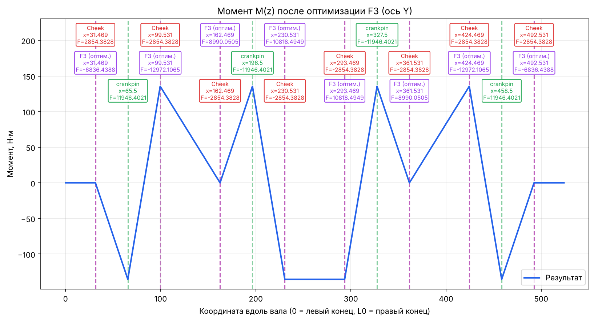

# crankshaft-balancing

[](https://github.com/rtte2077/crankshaft-balancing/actions/workflows/tests.yml)


Расчёт балансировки коленчатого вала **любой конфигурации**: любое число цилиндров,
рядный или V-образный двигатель, любая раскладка щёк и шатунных шеек.

Программа берёт описание вала (координаты и массы щёк и шеек, обороты) и:

1. считает центробежные силы инерции, действующие на щёки и шатунные шейки;
2. методом сечений строит эпюру изгибающего момента `M(z)` вдоль оси вала;
3. подбирает противовесы: коэффициенты, при которых максимальный момент минимален,
   а суммарная сила и момент на конце вала равны нулю (линейное программирование);
4. независимо проверяет, что найденный минимум действительно глобальный.



*Эпюра момента `M(z)` по оси Y после подбора противовесов для примера из репозитория.
Красные подписи — силы щёк (F1), зелёные — шатунных шеек (F2), фиолетовые — найденные
противовесы (F3).*

## Содержание

- [Что внутри и как это работает](#что-внутри-и-как-это-работает)
- [Установка](#установка)
- [Быстрый старт](#быстрый-старт)
- [Описание своего вала](#описание-своего-вала)
- [Система координат и единицы измерения](#система-координат-и-единицы-измерения)
- [Как читать результаты](#как-читать-результаты)
- [Использование из Python](#использование-из-python)
- [Проверка глобальности оптимума](#проверка-глобальности-оптимума)
- [Справочник по API](#справочник-по-api)
- [Структура репозитория](#структура-репозитория)
- [Тесты](#тесты)
- [Ограничения](#ограничения)
- [Частые вопросы](#частые-вопросы)
- [Лицензия](#лицензия)

## Что внутри и как это работает

### Силы

Центробежная сила элемента массой $m$ с центром масс на расстоянии $r$ от оси вала:

$$F = m \, r \, \omega^2$$

Сила направлена вдоль радиус-вектора центра масс в плоскости поперечного сечения (YZ)
и раскладывается на компоненты $F_x$, $F_y$. Расчёт ведётся отдельно по каждой оси.

Силы делятся на три группы:

| Группа | Что это |
|---|---|
| `F1` | щёки вала |
| `F2` | шатунные шейки; к массе шейки добавляется вращающаяся часть приведённой массы шатуна `rod_rotating_mass` |
| `F3` | противовесы: $F_3 = s \, \omega^2$, коэффициенты $s_i$ подбираются оптимизацией |

Метод приведения масс шатуна: часть массы $m_1$ считается сосредоточенной в поршневом
пальце (возвратно-поступательное движение, в этот расчёт не входит), часть $m_2$ — в
шатунной шейке (вращается вместе с валом). В программу передаётся именно $m_2$.

### Метод сечений

Момент в сечении `z` равен сумме моментов всех сил, приложенных с одной стороны от него:

$$M(z) = \sum_i H(z - L_i)\, F_i, \qquad H(d) = \begin{cases} d, & d > 0 \\ 0, & d \le 0 \end{cases}$$

Здесь $L_i$ — расстояние от **правого** конца вала до точки приложения силы $F_i$.
Функция $H$ нужна, чтобы силы с другой стороны от сечения не давали вклада.

### Подбор противовесов

Момент $M(z)$ линейно зависит от коэффициентов $s_i$, поэтому $\max|M(z)|$ — выпуклая
функция от $s$, и задача сводится к линейной программе:

$$\min\; t \quad \text{при} \quad -t \le M(z_k) \le t \;\; \forall k,$$

$$\sum F_1 + \sum F_2 + \sum F_3 = 0 \quad \text{(баланс сил)}, \qquad M(z_{\text{end}}) = 0 \quad \text{(момент на конце вала)}.$$

Решает её HiGHS (`scipy.optimize.linprog`). В отличие от градиентных методов на негладкой
функции `max(|...|)`, ЛП гарантирует глобальный минимум.

### Длина вала

Длина вала не задаётся вручную. Она вычисляется из геометрии последовательным
суммированием ширин элементов в порядке их следования вдоль вала (координаты центров
масс используются только для определения порядка):

- вал начинается с половины коренной шейки;
- щека добавляет `cheek_width`, шатунная шейка — `crankpin_journal_width`;
- если подряд идут две щеки без шатунной шейки между ними, между ними опорная коренная
  шейка, добавляется `main_journal_width`;
- вал заканчивается половиной коренной шейки.

Подробный вывод формул — в [docs/theory.md](docs/theory.md).

## Установка

Требуется Python 3.9 или новее.

```bash
git clone https://github.com/rtte2077/crankshaft-balancing.git
cd crankshaft-balancing

# рекомендуется — отдельное виртуальное окружение
python -m venv .venv
source .venv/bin/activate        # Windows: .venv\Scripts\activate

pip install -e .                 # numpy, scipy, matplotlib
```

Дополнительные наборы зависимостей:

```bash
pip install -e ".[interactive]"  # + plotly: интерактивный 3D-график
pip install -e ".[dev]"          # + pytest, plotly: для разработки
```

Ключ `-e` ставит пакет в режиме разработки: правки в `src/` сразу видны без переустановки.
После установки доступна команда `crankbalance`.

## Быстрый старт

### Из командной строки

```bash
crankbalance examples/example_shaft.json --verify --out output
```

Эквивалентно: `python -m crankshaft_balancing examples/example_shaft.json --verify --out output`.

Пример вывода:

```
Длина коленвала (из геометрии): 524.000 мм
Шаг колена (из геометрии):      131.000 мм
[y] max|M| = 135.5133 Н·м
[y] s = [-0.1178 -0.2235  0.1549  0.1864  0.1864  0.1549 -0.2235 -0.1178]
[y] баланс сил = -0.0 Н
[y] момент на конце M(z[-1]) = 0.0 Н·м
...
[y] условия ККТ выполнены -> ГЛОБАЛЬНЫЙ ОПТИМУМ ПОДТВЕРЖДЁН
```

Параметры командной строки:

| Параметр | Назначение |
|---|---|
| `config` | путь к JSON-файлу с валом (обязательный) |
| `--out ПАПКА` | куда сохранять графики (по умолчанию `output`) |
| `--step ММ` | шаг сетки сечений, мм (по умолчанию `0.01`); больший шаг считает быстрее, но чуть грубее |
| `--verify` | проверить глобальность оптимума (двойственность и ККТ) |
| `--no-plots` | только расчёт, без графиков |
| `--interactive` | дополнительно сохранить интерактивный 3D-график `moment_3d.html` (нужен plotly) |

Файлы, которые появляются в папке `--out`:

| Файл | Содержимое |
|---|---|
| `moment_x_raw.png`, `moment_y_raw.png` | эпюры момента до оптимизации |
| `moment_x_optimized.png`, `moment_y_optimized.png` | эпюры после подбора противовесов |
| `moment_3d.png` | суммарный момент $(M_x, M_y)$ вдоль вала |
| `moment_3d.html` | то же, интерактивно (только с `--interactive`) |

### Из Python

```python
from crankshaft_balancing import analyze, load_shaft

engine, components = load_shaft("examples/example_shaft.json")
res = analyze(engine, components)

print(res.max_moment_y)       # max|My| после оптимизации, Н·м
print(res.result_y["s"])      # коэффициенты противовесов по оси Y
print(res.result_y["F3"])     # силы противовесов, Н
```

Готовый скрипт — [`examples/run_example.py`](examples/run_example.py), пошаговая
демонстрация с графиками — [`notebooks/demo.ipynb`](notebooks/demo.ipynb).

## Описание своего вала

Вал задаётся JSON-файлом. За образец возьмите
[`examples/example_shaft.json`](examples/example_shaft.json):

```json
{
  "engine": {
    "angular_speed": 240.9,
    "rod_rotating_mass": 1.86,
    "main_journal_width": 37.0,
    "crankpin_journal_width": 38.0,
    "cheek_width": 28.0
  },
  "components": [
    {"kind": "cheek",    "x": 31.469, "y": 0, "z": 26.5926, "mass": 1.8496},
    {"kind": "crankpin", "x": 65.5,   "y": 0, "z": 64.0,    "mass": 1.3565}
  ]
}
```

### Блок `engine`

Все ключи необязательны; пропущенные берутся из значений по умолчанию (они совпадают
с примером).

| Ключ | Смысл | Единицы |
|---|---|---|
| `angular_speed` | угловая скорость вала ω | рад/с |
| `rod_rotating_mass` | вращающаяся часть массы шатуна, приведённая к шатунной шейке ($m_2$) | кг |
| `main_journal_width` | ширина коренной шейки | мм |
| `crankpin_journal_width` | ширина шатунной шейки | мм |
| `cheek_width` | ширина щеки | мм |

Три ширины используются **только** для автоматического вывода длины вала.

Перевод оборотов в угловую скорость: $\omega = 2\pi n / 60$, где $n$ — обороты в минуту.
Для $n = 2300$ об/мин получается $\omega \approx 240{,}9$ рад/с.

### Список `components`

Каждая щека и каждая шатунная шейка — отдельный элемент:

| Ключ | Смысл | Единицы |
|---|---|---|
| `kind` | `"cheek"` (щека) или `"crankpin"` (шатунная шейка) | — |
| `x` | положение центра масс вдоль оси вала | мм |
| `y`, `z` | положение центра масс в плоскости сечения | мм |
| `mass` | масса элемента | кг |

Порядок элементов в списке **не важен**: программа сама сортирует их по `x`.
Число элементов и их раскладка не ограничены, поэтому можно описать вал с любым числом
колен, V-образный вал с несимметричной раскладкой и т.п. Меняется только JSON.

Важно: у каждого элемента должен быть ненулевой радиус, то есть `y` и `z` не могут
быть одновременно нулями (направление силы определяется вектором $(y, z)$).

## Система координат и единицы измерения

- Ось `x` идёт вдоль оси вала; `y`, `z` лежат в плоскости поперечного сечения.
- Внутри расчёта координата сечения `z` отсчитывается от **правого** конца вала и растёт
  влево. На всех графиках она пересчитывается в обычную координату
  `x = L − z`, где 0 — левый конец вала.
- Длины и координаты — в **мм**, массы — в **кг**, силы — в **Н**.
- `result["M"]` хранится в **Н·мм**; графики и свойства `max_moment_x/y` — уже в **Н·м**.
  Перевод между ними — константа `NMM_TO_NM = 1e-3`.

## Как читать результаты

`analyze()` возвращает объект `BalanceResult`:

| Поле | Что это |
|---|---|
| `engine` | параметры с вычисленной `crankshaft_length` |
| `geometry` | массивы координат и масс щёк и шеек (отсортированы по `x`) |
| `Z` | сетка сечений, мм |
| `forces` | силы `F1`, `F2` и точки их приложения `L` (`ShaftForces`) |
| `module_width` | шаг колена, мм |
| `result_x`, `result_y` | результаты оптимизации по осям X и Y |
| `max_moment_x`, `max_moment_y` | максимальный модуль момента после оптимизации, Н·м |

Каждый из `result_x` / `result_y` — словарь:

| Ключ | Что это |
|---|---|
| `s` | коэффициенты противовесов $s_i$, по одному на щёку (в порядке возрастания `x`) |
| `F3` | силы противовесов $s_i \omega^2$, Н |
| `M` | эпюра момента после оптимизации, Н·мм |
| `success` | признак успешного решения ЛП |
| `result` | исходный объект `scipy.optimize.linprog` |
| `lp` | матрицы задачи (нужны проверкам оптимальности) |

**Смысл коэффициента `s`.** Сила противовеса $F_3 = s\,\omega^2$, а центробежная сила —
$m\,r\,\omega^2$, поэтому $s$ — это произведение массы противовеса на радиус его центра
масс (кг·м). Отдельные компоненты $s_x$ и $s_y$ задают вектор противовеса в плоскости
сечения; суммарный коэффициент — $\sqrt{s_x^2 + s_y^2}$ (функция `plot_moment_3d`
возвращает его как `s_combined`, а компоненты — как `s_vectors`). Знак показывает
направление вдоль соответствующей оси. Противовесы привязаны к позициям щёк, поэтому их
столько же, сколько щёк.

**Критерии корректного результата:**

- `success == True`;
- «баланс сил» и «момент на конце» в выводе равны нулю (с точностью до ~1e-6);
- при `--verify` выводится «ГЛОБАЛЬНЫЙ ОПТИМУМ ПОДТВЕРЖДЁН».

## Использование из Python

### Пошаговый расчёт без `analyze()`

```python
from crankshaft_balancing import (
    EngineConfig, ShaftComponent, build_geometry, derive_crankshaft_dimensions,
    section_grid, compute_forces, make_initial_coefficients,
    optimize_counterweights,
)

engine = EngineConfig(angular_speed=240.9, rod_rotating_mass=1.86)
components = [
    ShaftComponent("cheek",    31.469, 0,  26.5926, 1.8496),
    ShaftComponent("crankpin", 65.5,   0,  64.0,    1.3565),
    # ... остальные элементы
]

geometry = build_geometry(components)
engine.crankshaft_length, pitch = derive_crankshaft_dimensions(geometry, engine)

Z = section_grid(engine.crankshaft_length, step=0.01)
f = compute_forces(geometry, engine)

result_y = optimize_counterweights(
    Z, f.L_cheeks, f.Fy_cheeks, f.L_crankpins, f.Fy_crankpins,
    engine.angular_speed, make_initial_coefficients(len(f.Fy_cheeks)), axis="y",
)
```

### Зафиксировать часть противовесов

Значение `"F"` фиксирует коэффициент на нуле и исключает его из оптимизации
(например, на этой щеке противовес поставить нельзя):

```python
s_init = make_initial_coefficients(8, overrides={2: "F"})   # третья щека без противовеса
result = optimize_counterweights(Z, f.L_cheeks, f.Fy_cheeks, f.L_crankpins,
                                 f.Fy_crankpins, engine.angular_speed, s_init)
```

Чтобы зафиксировать коэффициент на **ненулевом** значении, передайте его в `s_init`
и отметьте индекс в `s_fixed`:

```python
s_init = make_initial_coefficients(8, overrides={0: 0.1})
s_fixed = [True] + [False] * 7
```

### Ограничить значения коэффициентов

`s_bounds` — список пар `(min, max)` по одной на каждую щёку:

```python
result = optimize_counterweights(..., s_bounds=[(-0.3, 0.3)] * 8)
```

Если ограничения несовместимы с условиями баланса, решателя не найдёт допустимого
решения, и функция выбросит `RuntimeError` с сообщением HiGHS.

### Графики

Все функции из `crankshaft_balancing.plotting` принимают `save_path` (сохранить файл)
и `show` (открыть окно) и возвращают объект `matplotlib.figure.Figure`:

```python
from crankshaft_balancing.plotting import plot_distribution, plot_moment_3d

plot_distribution(res.Z, res.result_y["M"] * 1e-3, res.engine.crankshaft_length,
                  title="Момент после оптимизации", ylabel="Момент, Н·м",
                  save_path="my_plot.png", show=False)

plot_moment_3d(res.Z, res.result_x, res.result_y,
               shaft_length=res.engine.crankshaft_length,
               interactive=True, save_path="moment_3d.html")   # нужен plotly
```

## Проверка глобальности оптимума

Три независимые проверки; ни одна не меняет результат оптимизации.

1. **Двойственный сертификат** — `verify_optimum_via_duality(result)`.
   Строится и решается двойственная задача ЛП. По теореме сильной двойственности
   оптимумы прямой и двойственной задач совпадают тогда и только тогда, когда решение
   глобально оптимально. Это самое строгое доказательство.
2. **Условия ККТ** — `verify_kkt_conditions(result)`. По множителям Лагранжа, которые
   уже вернул HiGHS, проверяются допустимость, стационарность и дополняющая
   нежёсткость.
3. **Чувствительность** — `sweep_sensitivity(...)` и `plot_sensitivity(...)`.
   Каждый коэффициент $s_i$ варьируется вокруг оптимума (остальные на оптимальных
   значениях), и `max|M|` пересчитывается напрямую по формуле, без решателя. Выпуклая
   «чаша» с минимумом в найденной точке — наглядное подтверждение. Это визуальная
   проверка, а не формальное доказательство, в отличие от пунктов 1 и 2.

```python
from crankshaft_balancing import verify_optimum_via_duality, verify_kkt_conditions

verify_optimum_via_duality(res.result_y, axis="y")
verify_kkt_conditions(res.result_y, axis="y")
```

### График сходимости симплекс-метода

`optimize_counterweights_history` возвращает значение `max|M|` на каждой итерации.
Используется метод `simplex` из SciPy: он устаревший, на порядки медленнее HiGHS и
доступен не во всех версиях SciPy, поэтому применяйте его на грубой сетке
(`section_grid(L, step=2.0)`). Если метод недоступен, будет выброшено `RuntimeError`
с пояснением; основной расчёт от этого не зависит.

## Справочник по API

Всё ниже импортируется напрямую из `crankshaft_balancing`, кроме графиков
(`crankshaft_balancing.plotting`).

| Функция / класс | Назначение |
|---|---|
| `analyze(engine, components, step=0.01)` | сквозной расчёт, возвращает `BalanceResult` |
| `load_shaft(path)` | читает JSON, возвращает `(EngineConfig, список ShaftComponent)` |
| `EngineConfig` | угловая скорость, масса шатуна, ширины сечений |
| `ShaftComponent(kind, x, y, z, mass)` | один элемент вала |
| `build_geometry(components)` | сортирует по `x`, раскладывает на щёки и шейки |
| `derive_crankshaft_dimensions(geometry, engine)` | длина вала и шаг колена |
| `compute_forces(geometry, engine)` | силы и точки приложения (`ShaftForces`) |
| `raw_moments(Z, forces)` | эпюры $M_x$, $M_y$ до оптимизации, Н·м |
| `section_grid(length, step)` | сетка сечений |
| `total_distribution(z, L1, F1, L2, F2, F3, L3)` | момент по методу сечений, Н·мм |
| `make_initial_coefficients(n, default, overrides)` | начальные `s` с возможностью фиксации |
| `build_counterweight_lp(...)` | собирает матрицы ЛП |
| `optimize_counterweights(...)` | подбор противовесов (HiGHS) |
| `optimize_counterweights_history(...)` | то же с историей итераций (simplex) |
| `verify_optimum_via_duality`, `verify_kkt_conditions` | сертификаты оптимальности |
| `sweep_sensitivity(...)` | вариация `s_i` вокруг оптимума |
| `plotting.plot_distribution` | эпюра момента с подписями сил |
| `plotting.plot_moment_3d` | 3D-график $(M_x, M_y)$, статичный или интерактивный |
| `plotting.plot_convergence`, `plotting.plot_sensitivity` | сходимость и чувствительность |

У каждой функции есть docstring с описанием параметров: `help(optimize_counterweights)`.

## Структура репозитория

```
crankshaft-balancing/
├── src/crankshaft_balancing/
│   ├── config.py        # EngineConfig: режим работы и ширины сечений
│   ├── geometry.py      # ShaftComponent, build_geometry, вывод длины вала
│   ├── forces.py        # центробежные силы
│   ├── sections.py      # метод сечений, M(z)
│   ├── optimization.py  # ЛП для подбора противовесов
│   ├── verification.py  # двойственность, ККТ, чувствительность
│   ├── plotting.py      # все графики
│   ├── analysis.py      # analyze() — сквозной расчёт
│   ├── loader.py        # чтение вала из JSON
│   └── cli.py           # команда crankbalance
├── examples/
│   ├── example_shaft.json   # пример вала (4 колена, 12 элементов)
│   └── run_example.py       # пример использования как библиотеки
├── notebooks/demo.ipynb     # демонстрация с графиками
├── tests/                   # pytest
├── docs/theory.md           # постановка задачи и формулы
├── .github/workflows/       # автотесты на GitHub Actions
├── pyproject.toml           # метаданные пакета и зависимости
└── requirements.txt
```

## Тесты

```bash
pip install -e ".[dev]"
pytest
```

Что проверяют тесты:

- геометрию: порядок ввода не влияет на результат, неизвестный тип элемента отклоняется,
  длина и шаг колена для примера равны 524 и 131 мм;
- силы: единицы измерения, направление векторов;
- метод сечений: линейность момента от одной силы;
- оптимизацию: нулевой баланс сил и нулевой момент на конце вала, симметрия коэффициентов
  для симметричного вала, значение max|M| (регрессия по исходному расчёту), фиксация
  коэффициентов, сертификаты двойственности и ККТ;
- командную строку: создание файлов графиков.

## Ограничения

- Все силы считаются в плоскости YZ поперечного сечения, вал считается абсолютно
  жёстким; прогибы и собственные частоты не рассматриваются.
- Противовесы привязаны к позициям щёк (`L3 = L1` по умолчанию); параметр `L3` в
  `optimize_counterweights` позволяет задать другие точки на уровне Python-API.
- Минимизируется максимум момента по длине вала при условии нулевой силы и нулевого
  момента на конце. Другие критерии (например, нагрузки на опоры) не реализованы.
- В примере момент по оси X нулевой по построению (все центры масс лежат в плоскости
  `y = 0`), для неё оптимизация тривиальна.
- Мелкая сетка (`--step 0.01`) даёт десятки тысяч сечений и крупные матрицы ЛП; проверка
  двойственности строит ещё более крупную задачу. Для быстрых прикидок используйте
  `--step 0.1`.
- `optimize_counterweights_history` зависит от устаревшего метода `simplex` (см. выше).
- Результат — расчётная модель, а не заменитель инженерной верификации.

## Частые вопросы

**В силах появились `nan` и предупреждение о делении на ноль.** Для какого-то элемента
`y = z = 0`: радиус нулевой, направление силы не определено. Задайте координаты центра масс.

**`Неизвестный тип элемента`.** В `kind` допустимы только `"cheek"` и `"crankpin"`.

**Как получить длину вала, не запуская оптимизацию?**
`derive_crankshaft_dimensions(build_geometry(components), engine)`.

**Расчёт идёт слишком долго.** Увеличьте `--step` (или параметр `step` в `analyze`);
`--verify` включайте, когда нужна именно проверка.

**Как поменять обороты?** Измените `angular_speed` в блоке `engine` (рад/с).
Моменты пропорциональны $\omega^2$, а коэффициенты `s` от оборотов не зависят.

**Как описать вал с другим числом цилиндров?** Просто перечислите его щёки и
шатунные шейки в `components`. Менять код не нужно.

## Лицензия

MIT — см. [LICENSE](LICENSE).
